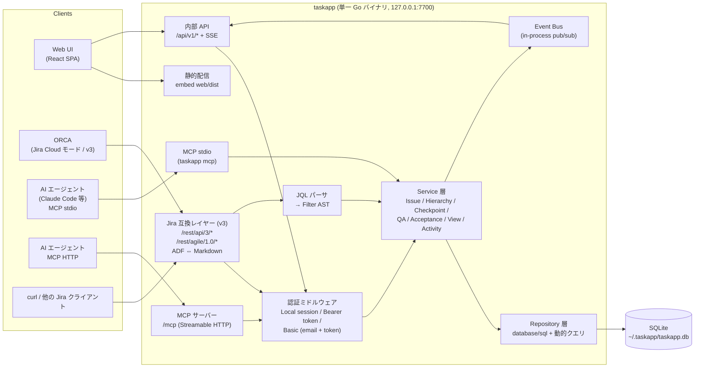
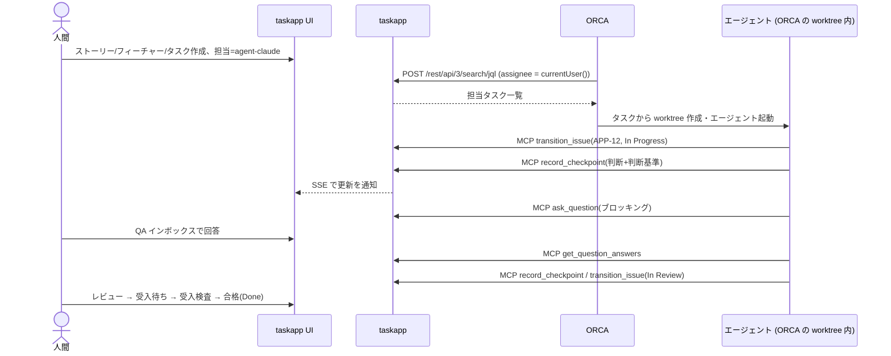

# 02. アーキテクチャ設計

## 1. 方針

1. **内部モデルは Linear ライク、Jira 互換 API は変換レイヤー**。
   ドメインは「単一の issues テーブル + 自己参照 parent_id + 種別 + カテゴリ付きステータス」というシンプルな形にする。Jira の概念（issuetype ID、statusCategory、resolution、transitions、JQL）は `internal/jira` パッケージの中だけで扱い、ドメインに漏らさない。
2. **入口は 4 つ、ロジックは 1 つ**。Web UI 用 API、Jira 互換 API、MCP（HTTP / stdio）はすべて同じ Service 層を呼ぶ。階層規則・採番・履歴記録は Service 層で一元的に保証する。
3. **単一バイナリ**。Go の `embed` で React のビルド成果物を同梱し、`taskapp serve` だけで UI・API・MCP が立ち上がる。
4. **ローカルファースト**。SQLite（WAL モード）、既定は `127.0.0.1` で listen、トークン認証。ほかの端末から使うときだけ `--host` で開き、画面はパスワードでログインする（§5.6）。

## 2. 技術スタック

| 層 | 採用技術 | 理由 |
|---|---|---|
| 言語 (BE) | Go 1.23+ | 単一バイナリ、クロスコンパイル容易 |
| HTTP | `net/http` + `chi` | 標準寄りで軽量。ルーティングのみ利用 |
| DB | SQLite (`modernc.org/sqlite`, cgo 不要) | ローカル単独。将来 PostgreSQL へ移行できるよう SQL は標準寄りに |
| SQL | `database/sql` + 手書き SQL（動的フィルタは自前の小さなビルダー） | ORM・コード生成に依存せず、SQL をそのまま別言語へ移植できる |
| マイグレーション | `pressly/goose`（ライブラリとして利用、素の SQL ファイルを embed） | `-- +goose Up/Down` 形式の素の SQL なので Rust 側でも再利用できる |
| MCP | `github.com/modelcontextprotocol/go-sdk`（公式） | stdio と Streamable HTTP の両対応 |
| リアルタイム | Server-Sent Events (`/api/v1/events`) | エージェントの更新を UI に即時反映。WebSocket より単純 |
| 言語 (FE) | TypeScript + React 19 + Vite | |
| ルーティング / データ取得 | TanStack Router / TanStack Query | URL にフィルタ状態を持たせやすい |
| UI 部品 | Radix UI + Tailwind CSS + cmdk（コマンドパレット） | Linear 風の UI を作りやすい |
| リスト/ツリー | TanStack Table + `@tanstack/react-virtual` | 1 万件の仮想スクロール |
| ボード | `dnd-kit` | ドラッグ&ドロップ |
| マインドマップ | `@xyflow/react` (React Flow)。レイアウトは横向きのツリー配置を自前で計算（elkjs は使わない） | ノードに React コンポーネント（ステータス、進捗バー）を描ける。木構造だけなら自前の配置で十分で、依存と容量を減らせる |
| テスト | **API テスト: TypeScript + Vitest（`apitest/`、実装非依存のブラックボックス）**、画面テスト: Playwright（`e2e/`、同じくバイナリを起動して操作）、Go 単体: `testing` | API テストと画面テストはバイナリを起動して外から操作するだけなので、Rust 版にもそのまま使える。使い方は [07 テストの使い方](07-testing.md) |

## 3. システム構成



### ORCA とエージェントの連携イメージ



## 4. レイヤー構成とパッケージ

```
task-app/
├── cmd/taskapp/            # main: serve / mcp / migrate / token / seed / export / import / backup / restore
├── internal/
│   ├── domain/             # エンティティ、値オブジェクト、階層規則 (外部依存なし)
│   │   ├── issue.go        #   IssueType, StatusCategory, Priority
│   │   ├── hierarchy.go    #   CanBeChild(parentType, childType, opts)
│   │   └── filter.go       #   Filter AST (UI フィルタ / JQL 共通の中間表現)
│   ├── store/              # Repository 実装
│   │   ├── migrations/     #   goose SQL
│   │   ├── filtersql.go    #   Filter AST → SQL
│   │   ├── dump.go         #   エクスポート / インポート / バックアップ
│   │   └── restore.go      #   バックアップからの復元
│   ├── backup/             # 自動バックアップ（定期実行・世代管理）
│   ├── service/            # ユースケース。トランザクション境界・履歴記録・イベント発行
│   ├── auth/               # トークン発行/検証、ミドルウェア、Actor 解決
│   ├── httpapi/            # 内部 API (/api/v1) + SSE
│   ├── jira/               # Jira 互換レイヤー
│   │   ├── handlers.go     #   /rest/api/3/*, /rest/agile/1.0/*
│   │   ├── adf/            #   ADF ⇔ Markdown 変換
│   │   ├── mapping.go      #   内部 ⇔ Jira JSON 変換
│   │   └── jql/            #   lexer, parser → domain.Filter
│   ├── mcpserver/          # MCP ツール/リソース/プロンプト定義
│   └── events/             # in-process pub/sub
├── web/                    # React SPA (Vite)
│   └── src/
│       ├── routes/         #   TanStack Router のルート
│       ├── features/       #   issues, board, tree, mindmap, qa, acceptance, agents
│       ├── components/     #   UI 部品
│       └── api/            #   API クライアント (OpenAPI から生成)
├── api/openapi.yaml        # 内部 API 仕様（契約。TS の型をここから生成）
├── apitest/                # 実装非依存の API テスト (TypeScript + Vitest)
├── e2e/                    # 実装非依存の画面テスト (Playwright)
└── docs/
```

依存の向き: `httpapi / jira / mcpserver → service → domain ← store`。`domain` は何にも依存しない。

## 5. 主要な設計判断

### 5.1 階層は単一テーブルの自己参照

- `issues.parent_id` で親を表し、種別ごとの親子規則は `domain.CanBeChild` で検証する（DB 制約ではなくアプリ側。規則がプロジェクト設定で変わるため）。
- 子孫の取得は SQLite の **再帰 CTE** を使う。進捗集計（子孫の完了数/総数）は更新時に計算せず、クエリ時に再帰 CTE で計算する。1 万件規模なら十分速く、整合性の問題が起きない。性能が足りなければ `issue_closure` テーブルの導入を検討する。
- 循環防止: 親付け替え時に「新しい親の祖先に自分が含まれないか」を再帰 CTE で確認する。

### 5.2 Filter AST を共通の中間表現にする

UI のフィルタ（JSON）、保存ビュー、JQL、MCP の `search_issues` はすべて `domain.Filter` に変換してから SQL を生成する。こうすると JQL 対応を広げても検索ロジックは 1 か所で済む。

```
UI フィルタ JSON ─┐
保存ビュー        ├─→ domain.Filter (AND/OR/NOT, 比較) ─→ filtersql → SQL
JQL 文字列 ──parser┘
```

### 5.3 チェックポイントは専用テーブル

チェックポイントは「判断基準」「確信度」「進捗率」などの構造化された項目を持ち、エージェント活動フィードや「確信度低」一覧で横断検索するため、コメントとは別の `checkpoints` テーブルにする。Jira API 経由ではコメントとして見えるよう変換する（読み取り時に `[Checkpoint]` 見出し付きのコメントとしてマージ）。

### 5.4 QA はチケット種別 + 拡張テーブル

QA は担当・ステータス・コメント・ORCA からの見え方など、チケットの機能をすべて使えるため `issues.type = 'qa'` とする。QA 固有の項目（選択肢、暫定判断、回答、ブロッキング）は 1:1 の `qa_details` に持つ。

### 5.5 受入検査はステータス + 記録テーブル

「受入待ち」は `started` カテゴリのステータスとして持つ（ボード上の 1 列として自然に見える）。受入基準は `acceptance_criteria`、判定は `acceptance_reviews`（基準ごとの結果は `acceptance_review_items`）に記録する。

### 5.6 認証

| 経路 | 方式 |
|---|---|
| Web UI（この PC） | パスワードなしでオーナーとして自動ログイン（`POST /auth/local` → HttpOnly・SameSite=Strict の Cookie セッション）。接続元アドレスと `Host` ヘッダーの両方がループバック（`127.0.0.1` / `::1` / `localhost`）のときだけ許す。`--require-login` で無効化 |
| Web UI（ほかの端末） | 人間のユーザー名 + パスワード（`POST /auth/login`）。エージェントはパスワードを持てない |
| Jira 互換 API (v3) | `Basic base64(email:token)`（ORCA Cloud モードの方式。email の代わりにユーザー名も可）、または `Authorization: Bearer <token>` |
| MCP HTTP | `Authorization: Bearer <PAT>` |
| MCP stdio | 環境変数 `TASKAPP_TOKEN`（DB を直接開き、トークンから Actor を解決） |

PAT は `taskapp token create --user agent-claude` か設定画面で発行する。認証には DB の SHA-256 ハッシュだけを使う。設定画面で後から表示できるよう、暗号化した控え（`token_enc`、AES-256-GCM）も保存する。鍵は `<data>/token.key`（32 バイト、0600、初回に作る）で、DB・バックアップ・エクスポートには入らない。鍵が読めないときは警告を出して続け、その間に発行したトークンは後から表示できない。控えを読めるのはオーナー（全トークン）とトークンの持ち主だけ（`POST /api/v1/tokens/{id}/reveal`）。控えがない（この仕組みより前に発行した）か鍵が変わったトークンは 409 `not_available` で、発行し直す（2026-10-12 の変更。それまではハッシュだけを保存していた）。リクエストごとに Actor（ユーザー + 経路 ui/jira/mcp）を context に載せ、Service 層が履歴に記録する。

#### ほかの端末からのログイン（01 §4.12）

- **パスワード**: `users.password_hash` に `pbkdf2-sha256$<回数>$<ソルト>$<鍵>`（PBKDF2-HMAC-SHA256、60 万回、ソルト 16 バイト、鍵 32 バイト、base64 はパディングなし）で保存する。パラメーターを文字列に含めるので、Rust など別の実装でも同じハッシュを検証できる（Go の単体テストに Python で作ったハッシュの検証がある）。API の応答には `has_password` だけを返し、エクスポートにも含めない（取り込み後に設定し直す）。設定は `PUT /users/{username}/password`（本人。2 回目以降は今のパスワードが必要。オーナーは誰のものでも設定・解除できる）か `taskapp passwd`。
- **セッション**: DB の `sessions` に Cookie の値の SHA-256 だけを持つので、再起動（デプロイ）してもログインが続く（2026-10-12 から。それまではメモリだけで、再起動でログインし直しだった）。最後に使ってから 1 日で切れ、ログイン画面で「ログインしたままにする」を選ぶと 30 日（Cookie にも Max-Age を付け、ブラウザを閉じても残る。付けないときはブラウザを閉じると消える）。有効期限は使うたびに延びる（DB への書き込みは 10 分に 1 回まで）。https で届いたとき（`X-Forwarded-Proto: https` を含む）は Cookie に Secure を付ける。ログアウトで破棄し、パスワードを変えるとその人のほかのセッションも破棄する。エクスポートには入れない。
- **自動ログインをこの PC に限る理由**: 接続元だけを見ると、DNS リバインディング（`Host: attacker.example` で 127.0.0.1 に届く）や、この PC 上のリバースプロキシ（`tailscale serve` など、接続元は 127.0.0.1 になる）経由でも通ってしまう。`Host` も見ることで、どちらもログイン画面になる。
- **総当たり対策**: 同じ接続元から 5 回続けて失敗すると、1 分間 `429 rate_limited` を返す。存在しないユーザーでも同じ時間をかけて同じ 401 を返す。
- **通信路**: アプリは HTTP のまま。ほかの端末からは自宅・社内の LAN か VPN（Tailscale など）の中で使う前提で、`--host` が外部向けのとき起動時に警告する。HTTPS 化はスコープ外。
- **MCP（HTTP）**: もともとトークン認証なので、ほかの端末からも使える。MCP SDK の DNS リバインディング対策（ループバックで受けたリクエストの `Host` がループバック以外なら 403）はそのまま有効で、LAN の IP に届いたリクエストは通る。
- **リバースプロキシの後ろ（`--behind-proxy`）**: 同じマシンのプロキシ（`tailscale serve` など）は 127.0.0.1 に公開名の `Host` で転送するため、上の対策で MCP が 403 になる。`--behind-proxy` はこの対策を外す（トークンは引き続き必須で、ブラウザはトークンを勝手に付けないので、DNS リバインディングでは使えない）。同時に自動ログインも止める。接続元がすべてループバックになり、`Host` は接続してくる側が自由に書けるので、`Host` だけでは「この PC」と判断できないため。`--public-url` は設定画面に出す URL（`remote_url`）を指定する。

### 5.7 MCP stdio と HTTP サーバーの同時起動

stdio モードは同じ SQLite ファイルを開く（WAL モードで複数プロセスの読み書きが可能）。stdio から書き込んだ変更を起動中の UI に届けるため、stdio プロセスは書き込み後に `serve` プロセスの内部通知エンドポイント（`POST /api/v1/internal/notify`、localhost のみ）を呼ぶ。`serve` が起動していなければ通知はスキップする。

### 5.8 リアルタイム更新

Service 層が変更確定後に `events.Bus` へ `{type, projectId, issueKey}` を発行し、SSE で UI に送る。UI は TanStack Query の該当キャッシュを無効化して再取得する（差分パッチはしない）。

## 6. 内部 API（/api/v1）概要

| メソッド | パス | 用途 |
|---|---|---|
| GET | `/me` | 現在のユーザー |
| GET/POST/PATCH | `/projects`, `/projects/{key}` | プロジェクト |
| GET | `/projects/{key}/states`, `/labels`, `/members` | 設定 |
| GET | `/issues?filter=<json>&view=list\|tree&sort=...` | 一覧（フィルタ、ツリー時は祖先も返す） |
| POST | `/issues` | 作成 |
| GET/PATCH/DELETE | `/issues/{key}` | 詳細・更新・削除 |
| POST | `/issues/{key}/move` | 親付け替え・並び替え |
| GET | `/issues/{key}/tree` | 配下ツリー（マインドマップ用、進捗込み） |
| GET/POST | `/issues/{key}/comments` | コメント |
| GET/POST | `/issues/{key}/checkpoints` | チェックポイント |
| GET | `/issues/{key}/activity` | 変更履歴 |
| GET/PUT | `/issues/{key}/acceptance-criteria` | 受入基準 |
| POST | `/issues/{key}/acceptance-reviews` | 受入判定 |
| POST | `/issues/{key}/answer` | QA 回答 |
| GET | `/inbox/qa`, `/inbox/acceptance`, `/my/issues` | 受信箱系 |
| GET | `/agents/activity` | エージェント活動フィード |
| GET/POST/PATCH/DELETE | `/views` | 保存ビュー |
| GET/POST/DELETE | `/tokens` | API トークン |
| GET | `/events` | SSE |

## 7. Jira 互換レイヤーの詳細

**対象は Jira REST API v3**（`/rest/api/3`）。v3 固有の点:

| 項目 | v3 での扱い |
|---|---|
| 説明・コメント | ADF（JSON の文書ツリー）。内部は Markdown のまま保存し、入出力時に `internal/jira/adf` で変換する。対応ノード: paragraph, heading, bulletList, orderedList, listItem, codeBlock, blockquote, rule, hardBreak, text（strong/em/code/link/strike）。未対応ノードはテキストに落とす |
| ユーザー | `accountId` = 内部ユーザー ID（ULID）。`accountType` は人間 `atlassian`、エージェント `app`。全ユーザーにメールアドレスを持たせる（未設定なら `<username>@taskapp.local`） |
| ID | プロジェクト・イシュー・コメントは `jira_id`（数値、10000 から採番）を `id` として返す。パスの `{issueIdOrKey}` はキーと数値 ID の両方を受け付ける |
| 検索 | `POST/GET /search/jql`。ページングは `nextPageToken`（不透明な文字列。内部では offset をエンコード）、`isLast` |
| プロジェクト一覧 | `GET /project/search`（`startAt`/`maxResults`/`total`/`isLast`/`values`） |
| 認証 | Basic `email:token`。users.email でユーザーを特定し、トークンを検証する |

### 7.1 固定 ID

| issuetype | id | subtask |
|---|---|---|
| Epic | 10000 | false |
| Story | 10001 | false |
| Feature | 10002 | false |
| Task | 10003 | false |
| Question (QA) | 10004 | false |

issuetype は `hierarchyLevel` も返す（Epic 1 / Story・Feature・Task・Question 0）。`statusCategory`: `new`(id 2) / `indeterminate`(id 4) / `done`(id 3)。ステータス ID は `workflow_states.id` をそのまま使う。transition ID は「遷移先のステータス ID」と同じにする（遷移制約がないため、全ステータスを transitions として返す）。

### 7.2 エラー形式

```json
{ "errorMessages": ["Error in the JQL Query: ..."], "errors": {} }
```

ORCA は 400 応答本文の `Error in the JQL Query` を見て、テキスト検索に切り替えるため、文言を合わせる。
認証エラーは必ず 401。ORCA は 401 を受けると保存済みのサイト設定を消すため、権限などそれ以外の失敗には 401 を使わない。
PUT（更新・担当者）と遷移の POST は **204・本文なし** で返す（ORCA は 204 以外では本文を JSON として読む）。

### 7.3 実装の構成

| パッケージ | 役割 |
|---|---|
| `internal/jira` | ルーティング、認証、Jira JSON への変換、`[Checkpoint]` コメントの解釈、アバター SVG |
| `internal/jira/jql` | JQL の字句解析・構文解析と `domain.Filter` への変換（DB に依存しない） |
| `internal/jira/adf` | ADF ⇔ Markdown 変換（Markdown の解析に goldmark） |

`serve --log-requests` を付けると、Jira API を含むすべての API リクエストをクエリ文字列・User-Agent つきでログに出す（未知のクライアントをつなぐときの調査用）。

### 7.4 互換性の検証

- `apitest/tests/jira.test.ts`: ORCA が送るリクエスト（Basic `email:token`、`User-Agent: Orca`、フィールド指定、ADF 本文）を再現した API テスト。実装を Rust に置き換えるときもこのテストで互換性を確かめる。
- `scripts/jira-smoke.sh`: 起動中のサーバーに curl で同じ流れ（接続 → 一覧 → 作成 → 更新 → 遷移 → コメント）を流す確認スクリプト。
- 実機確認: ORCA の Settings → Jira で **Cloud** を選び、サイト URL に `http://127.0.0.1:7700`、メールアドレスと API トークンを設定して、タスク一覧・詳細・作成・遷移・コメントを確認する。

## 8. 運用

- データディレクトリ: `~/.taskapp/`（`taskapp.db`。`--data` か `TASKAPP_DATA` で変更）
- 起動: `taskapp serve [--port 7700] [--data ~/.taskapp]`
- ほかの端末から: `taskapp serve --host 0.0.0.0`。設定画面に LAN の URL（`GET /server` の `remote_url`）を出す。パスワードは `taskapp passwd --user <名前>` か設定画面で設定する。`serve.json` には `0.0.0.0` ではなく接続できるアドレス（`127.0.0.1:<port>`）を書く（`taskapp mcp` の通知と `restore` の起動確認が使う）
- MCP 登録例（Claude Code）:
  ```bash
  claude mcp add taskapp -e TASKAPP_TOKEN=tk_xxx -- taskapp mcp
  # または HTTP
  claude mcp add --transport http taskapp http://127.0.0.1:7700/mcp --header "Authorization: Bearer tk_xxx"
  ```
- 自動バックアップ: `serve` が起動時とその後 `--backup-interval`（既定 24h、`0` で無効）ごとに、前回から DB が変わっていれば `--backup-dir`（既定 `<data>/backups`）へ `taskapp-YYYYMMDD-HHMMSS.db` を作り、新しい `--backup-keep`（既定 7）件を残す。`VACUUM INTO` で `.tmp` に書いてから名前を変えるので、途中で止まっても不完全なファイルは残らない。判定は 1 分ごと（スリープ明けにも追いつく）。状態と「今すぐ」は `GET/POST /api/v1/backups`（オーナーのみ）
- 利用状況: `GET /api/v1/capacity`（オーナーのみ）が件数（イシュー・未完了・最大のプロジェクト・履歴）、データベース・バックアップ・データディレクトリの大きさ、ディスクの全体と空き（Unix の statfs。Windows は不明）、プロセスのメモリを返す。上限（性能を確かめた 1 万件、一覧の読み込み 2,000 件、マップ 1,000 ノード）は画面側に持ち、到達率を出す
- 手動バックアップ: `taskapp backup`（自動と同じフォルダへ）/ `taskapp backup --out backup.db`。起動中でも可
- 復元: `taskapp restore --from FILE`。サーバー起動中（`serve.json` のアドレスに接続できる）なら断る。いまの DB は `taskapp.db.before-restore-<日時>` に `VACUUM INTO` で退避し、`-wal` / `-shm` を消してから置き換え、マイグレーションを当てる
- エクスポート / 復元: `taskapp export --out data.json` → `taskapp import --data <空のディレクトリ> --in data.json`。テーブル単位の JSON で ID・トークンのハッシュ（と暗号化した控え。読むには元の `token.key` が要る）を保つ
- 配布: `make dist`（`CGO_ENABLED=0` で macOS / Linux / Windows × amd64 / arm64）、または GoReleaser（`.goreleaser.yaml`）。Web UI はビルド時にバイナリへ埋め込む
