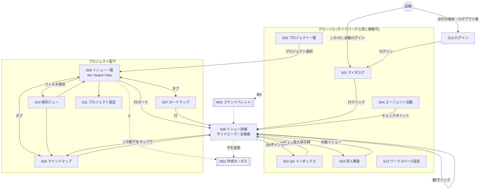
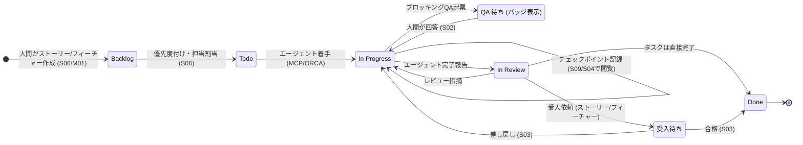

# 03. 画面設計（画面一覧・画面イメージ・遷移図）

## 1. 画面一覧

| ID | 画面 | URL | 概要 | 関連要求 |
|---|---|---|---|---|
| S01 | マイタスク | `/my` | 全プロジェクト横断の自分の担当。タブ: 担当 / 起票 / 回答待ち QA | VIEW-04 |
| S02 | QA インボックス | `/inbox/qa` | エージェントからの質問一覧と回答 | QA-03〜07 |
| S03 | 受入検査 | `/inbox/acceptance` | 受入待ちのストーリー/フィーチャーと判定 | ACC-02〜05 |
| S04 | エージェント活動 | `/agents` | チェックポイントのフィード、確信度低のハイライト | AGT-04, 05 |
| S05 | プロジェクト一覧 | `/projects` | プロジェクトと進捗。ティア（注力・通常・その他）ごとに分けて並べ、カードの印からティアを変えられる | PRJ-01, 05, 06 |
| S06 | イシュー一覧 | `/p/:key/issues?view=list\|board\|tree&f=...` | フィルタ・グルーピング・表示切替 | VIEW-01〜03, 06 |
| S07 | ロードマップ | `/p/:key/issues?view=roadmap` | エピック → ストーリーの進捗一覧（S06 の表示切替の 1 つ） | VIEW-07 |
| S08 | マインドマップ | `/p/:key/issues?view=map&root=APP-1&f=...` | 階層のマインドマップ表示（S06 の表示切替の 1 つ） | MAP-01〜05 |
| S09 | イシュー詳細 | `/p/:key/issues/:issueKey`（サイドピークでも表示） | 説明、満たすストーリー、子、チェックポイント、QA、受入基準（ストーリーの条件から写す）、コメント、履歴 | ISS, AGT-03, REQ-07, 08 |
| S10 | 保存ビュー | `/views/:id` | 保存したフィルタと表示で S06〜S08 を表示（プロジェクト横断のビューも同じ URL） | VIEW-05 |
| S11 | プロジェクト設定 | `/p/:key/settings` | ティア、ステータス、ラベル、階層規則 | PRJ-04, 06, HIE-07 |
| S12 | ワークスペース設定 | `/settings` | アカウント（パスワード）、メンバー/エージェント、ほかの端末から使う、API トークン、MCP 接続情報、Jira 互換 API 情報、データ（エクスポート・自動バックアップ。オーナーのみ） | MCP-03, JIRA-03, NFR-02, MD-02〜07 |
| S15 | ストーリーマップ | `/p/:key/storymap?persona=APP-P1&peek=APP-ST1&panel=true` | 活動と手順を横に、リリースを縦に並べ、手順の下にストーリーのカード（色 = つながったイシューの状態）。抜けの一覧、ペルソナで絞り込み、左にペルソナとジョブのパネル。S06 のヘッダーから入る。案 D: 上に **ひとこと入力**（Enter で未整理へ）、最初の列が **未整理**、リリースのない行は「未定」。ペルソナが 0 件なら絞り込みを出さず、活動が 0 件ならリリース × 未整理だけ。抜けは数だけ（警告の色なし） | REQ-01〜06, 09, 12 |
| S16 | ストーリー詳細 | S15 のサイドピーク（`peek`） | タイトルの下に **本文**（Markdown）。ペルソナ（ペルソナがあるときだけ）・リリース・手順（なければ「未整理」）。したいこと・そうすれば は「項目を足す」で。受け入れ条件は 1 行（☐）で、前提・操作は「詳しく」。つながったイシュー、変更履歴 | REQ-03, 04, 06, 10, 11 |
| S14 | 全体ボード | `/board?lanes=none&f=...` | 全プロジェクトのボード。列はステータスの分類、行はプロジェクト。リストにも切り替えられる | VIEW-08 |
| S13 | ログイン | `/login?next=...` | ユーザー名とパスワード。この PC からは「このPCのオーナーとして入る」も出す。サイドバーのない単独の画面 | MD-02, MD-05 |
| M01 | イシュー作成モーダル | （どこからでも `C`） | 種別・親・プロジェクトを選んで作成 | ISS-02 |
| M02 | コマンドパレット | （`Cmd+K`） | 画面移動、イシュー検索、操作 | ISS-07 |

## 2. 共通レイアウト

```
┌──────────────────────┬───────────────────────────────────────────────────────────┐
│ ◉ task-app      ⌘K   │  ヘッダー: パンくず / 表示切替 / フィルタ / ＋新規              │
│──────────────────────│───────────────────────────────────────────────────────────│
│ 👤 マイタスク     12  │                                                           │
│ ❓ QA インボックス  3  │                                                           │
│ ✅ 受入検査        2  │                     メインコンテンツ                          │
│ 🤖 エージェント活動    │                                                           │
│──────────────────────│                                                           │
│ プロジェクト          │                                                           │
│ ▾ APP  タスク管理アプリ│                                                           │
│     イシュー          │                                                           │
│     ロードマップ       │                                                           │
│     マインドマップ     │                                                           │
│     ビュー ▸          │                                                           │
│       ・エージェント作業中│                                                         │
│       ・今週の期日     │                                                           │
│ ▸ WEB  Webサイト刷新  │                                                           │
│──────────────────────│                                                           │
│ ⚙ 設定               │                                                           │
└──────────────────────┴───────────────────────────────────────────────────────────┘
```

## 3. 画面イメージ

### S06 イシュー一覧（リスト表示 + ツリー）

```
APP › イシュー                         [リスト|ボード|ツリー]  [≡ グループ: ステータス ▾]  [＋新規]
┌─────────────────────────────────────────────────────────────────────────────────────┐
│ フィルタ: [種別: ストーリー,タスク ×] [担当: 🤖 claude ×] [ステータス: 未完了 ×]  ＋フィルタ  💾ビュー保存 │
└─────────────────────────────────────────────────────────────────────────────────────┘
 ▾ In Progress  4
   ⚑高  APP-12  📗 ログイン画面を実装する            ▸ APP-3 認証       🤖 claude   ◔ 60%  ❓1
   ─    APP-15  ▫  セッションCookieの設定             ▸ APP-12          🤖 claude   ◑
   ⚑中  APP-21  ▫  JQLパーサのテスト追加              ▸ APP-9           🤖 codex    ◔ 30%
   ─    APP-24  ▫  ボード画面のDnD                    ▸ APP-10          👤 kasa
 ▾ 受入待ち  1
   ⚑高  APP-3   📘 ユーザーとしてログインしたい         ▸ APP-1 基盤       👤 kasa     ● 100%
 ▾ Todo  6
   ...

 凡例: 🟪エピック 📘ストーリー 📗フィーチャー ▫タスク ❓QA / ❓1 = 未回答QAあり / ◔ 進捗(子孫完了率)
```

ツリー表示（同じフィルタで、該当イシューの祖先も薄く表示）:

```
 ▾ 🟪 APP-1  認証基盤                                           ●●●○○ 3/5
   ▾ 📘 APP-3  ユーザーとしてログインしたい        受入待ち       ●●●● 4/4
     ▾ 📗 APP-12 ログイン画面を実装する          In Progress   🤖 claude
         ▫ APP-15 セッションCookieの設定           In Progress   🤖 claude
         ▾ ▫ APP-16 バリデーション                Done
             ▫ APP-17 メール形式チェック           Done          ← タスクの下のタスク
         ❓ APP-18 パスワード規則はどれにしますか？   未回答         → 👤 kasa
```

### S06 ボード表示

```
 Backlog(8)     Todo(6)        In Progress(4)     In Review(2)     受入待ち(1)     Done(23)
┌──────────┐  ┌──────────┐   ┌──────────────┐   ┌────────────┐   ┌───────────┐
│APP-30    │  │APP-25    │   │APP-12  📗     │   │APP-20 ▫    │   │APP-3 📘    │
│▫ ログ出力 │  │▫ ...     │   │ログイン画面    │   │...         │   │ログインしたい│
│          │  │          │   │🤖claude ◔60% ❓│   │🤖codex     │   │👤kasa       │
└──────────┘  └──────────┘   └──────────────┘   └────────────┘   └───────────┘
```

> 一覧系の画面（マイタスク、全体ボード、プロジェクトのイシュー、保存ビュー）のヘッダーでは、新規・表示の切り替えなどの **操作をタイトルのすぐ右（左寄せ）** に置く。ワイドスクリーンでもマウスの移動を短くするため（2026-11-01）。フィルタバーのグループ・並び・ビューを保存も、右端ではなく「完了を隠す」の続きに置く。

### S14 全体ボード

ステータスはプロジェクトごとに違うので、列は共通の **分類** にする。カードにはそのプロジェクトでのステータス名を出す。

```
全体ボード 36 件 [＋新規] [ボード|リスト] [▤ プロジェクトで分ける]
[検索] [フィルタ] [□完了を隠す] [□★注力のみ] [ビューを保存]
             ◌ Backlog 4    ○ 未着手 9     ◑ 進行中 8     ● 完了 4     ⊘ キャンセル 0
★ 注力  2 プロジェクト · 33 件
▾ タスク管理アプリ★ ┌────────┐  ┌────────┐   ┌────────┐   ┌────────┐
  APP · 21        │APP-17  │  │APP-20  │   │APP-21  │   │APP-9   │
                  │◌Backlog│  │○ Todo  │   │◑In Prog│   │● Done  │
                  └────────┘  └────────┘   └────────┘   └────────┘
▾ 自宅サーバー★   ┌────────┐  ┌────────┐
  INFRA · 12      │INFRA-9 │  │INFRA-2 │ ...
○ 通常  ...
🌱 その他  1 プロジェクト · 2 件
▸ Security学習🌱  ◌ 1         ○ 1          ◑ 0          ● 0         ← たたんだ行（件数だけ）
```

- 行は **ティアの段**（★ 注力 → ○ 通常 → 🌱 その他）に分けて並べる。段の中はキーの順。「その他」の行は最初からたたんでおき、見出しのクリックで開く（開いた状態は画面を離れると戻る）。
- 行の見出しの印（★ / ○ / 🌱）を押すと、その場でティアを変えられる。
- 「注力のみ」をオンにすると、注力のプロジェクトだけになる（URL の `f` に `tiers:["focus"]`。保存ビューにも残る）。フィルタの「プロジェクトのティア」で通常・その他も選べる。マイタスクでも使える。

- カードを別の列へドラッグすると、そのイシューの **プロジェクトの、その分類の最初のステータス** になる（QA は QA 用のステータスへ、ほかは QA 用以外へ）。別のプロジェクトの行へは動かせない。
- 行ごとの各列の上に、そのプロジェクトのその分類の件数を出す。分類の中にステータスが複数あれば内訳も出す（例: `◑ 6（受入待ち 1・In Progress 5）`）。たたんだ行にも件数だけ出す。
- 「プロジェクトで分ける」を外すと行がなくなり、5 列にすべてのプロジェクトのカードが並ぶ（URL に `lanes=none`）。
- 「完了を隠す」をオンにすると、完了とキャンセルの **列ごと** 消える（プロジェクトのボード S06 も同じ）。
- 行の見出しをクリックすると、そのプロジェクトをたたむ。フィルタ・保存ビューはほかの一覧と同じ。プロジェクトを指定しない保存ビューのボード表示もこの形になる。
- サイドバー「全体ボード」、`G` → `B`、コマンドパレットから開く。

### S09 イシュー詳細

```
APP › APP-1 認証基盤 › APP-3 ログインしたい › APP-12                                   [⋯] [✕]
┌────────────────────────────────────────────────────┬──────────────────────────────┐
│ 📗 ログイン画面を実装する                              │ ステータス  ● In Progress ▾   │
│                                                    │ 優先度      ⚑ 高            │
│ 説明 (Markdown)                                     │ 担当        🤖 claude        │
│ メール+パスワードでログインできる画面。...               │ 起票        👤 kasa          │
│                                                    │ ラベル      frontend         │
│ ── 子イシュー (3)  ●●○ ──────────────── ＋追加 ─────  │ 親          📘 APP-3          │
│  ▫ APP-15 セッションCookieの設定   In Progress 🤖     │ 期日        10/20            │
│  ▫ APP-16 バリデーション           Done              │ 見積り      3                │
│  ❓ APP-18 パスワード規則は？       未回答 ⚠ブロッキング  │──────────────────────────────│
│                                                    │ 🔗 関連                      │
│ ── タブ: [アクティビティ] [チェックポイント] [受入基準] ─ │  blocks APP-24              │
│                                                    │──────────────────────────────│
│ 🤖 claude  チェックポイント #3   10/11 14:20  確信度:中 │ 🤖 エージェント作業状況         │
│ ┌────────────────────────────────────────────────┐ │  最終チェックポイント 5分前      │
│ │要約: フォームとAPI呼び出しを実装                     │ │  進捗 60%                     │
│ │判断: 状態管理は React Hook Form を採用               │ │  未回答QA 1件                  │
│ │判断基準: 既存依存に含まれる / バリデーション連携容易     │ │                              │
│ │代替案: Formik (依存追加が必要なため不採用)            │ │                              │
│ │次: エラー表示、QA APP-18 の回答待ち                  │ │                              │
│ │成果物: branch feat/login, commit a1b2c3            │ │                              │
│ └────────────────────────────────────────────────┘ │                              │
│ 👤 kasa  コメント  10/11 14:30                        │                              │
│  Formik じゃなくて OK です                            │                              │
│ ── ステータス変更 Todo → In Progress (🤖 claude, MCP)  │                              │
│ [コメントを書く...]                                   │                              │
└────────────────────────────────────────────────────┴──────────────────────────────┘
```

### S02 QA インボックス

```
QA インボックス                         [未回答 3] [回答済 5] [すべて]   フィルタ: [プロジェクト ▾]
┌───────────────────────────────┬──────────────────────────────────────────────────┐
│ ⚠ APP-18 パスワード規則は？      │ ❓ APP-18 パスワード規則はどれにしますか？  ⚠ブロッキング │
│   🤖 claude · APP-12 · 10分前   │ 対象: 📗 APP-12 ログイン画面を実装する                │
│   APP-27 ログの保存期間は？      │ 起票: 🤖 claude  10/11 14:18                      │
│   🤖 codex · APP-21 · 1時間前   │                                                  │
│   WEB-4 OGP画像のサイズ         │ 背景:                                             │
│   🤖 claude · WEB-2 · 昨日      │  要件にパスワード規則の記載がありません。...           │
│                               │ 選択肢:                                           │
│                               │  ○ A. 8文字以上 (推奨: 一般的・実装容易)              │
│                               │  ○ B. 12文字以上+記号必須                          │
│                               │  ○ C. その他 (自由記述)                             │
│                               │ エージェントの暫定判断: A で実装を進めています          │
│                               │                                                  │
│                               │ 回答: [                                        ]  │
│                               │                     [回答する]  [エージェントに一任] │
└───────────────────────────────┴──────────────────────────────────────────────────┘
```

### S03 受入検査

```
受入検査                                              [受入待ち 2] [履歴]
┌───────────────────────────────┬──────────────────────────────────────────────────┐
│ 📘 APP-3 ログインしたい          │ 📘 APP-3 ユーザーとしてログインしたい  （受入 2回目）  │
│   子 4/4 完了 · QA 0            │ 子イシュー: 4/4 完了   未回答QA: 0   ✓ 判定可能         │
│ 📗 WEB-8 ヘッダー刷新            │                                                  │
│   子 2/3 完了 ⚠                 │ 受入基準                         判定   コメント     │
│                               │ 1. 正しい資格情報でログインできる   [OK▾]  [      ]   │
│                               │ 2. 誤りで5回失敗するとロック        [NG▾]  [解除不可] │
│                               │ 3. ログイン状態が7日保持される       [OK▾]  [      ]   │
│                               │                                                  │
│                               │ 総評: [                                         ] │
│                               │          [✗ 差し戻し (→ In Progress)]  [✓ 合格 (→ Done)] │
│                               │ 前回: 10/09 差し戻し (👤kasa) 「エラー文言が英語」       │
└───────────────────────────────┴──────────────────────────────────────────────────┘
```

### S08 マインドマップ

```
APP › マインドマップ   ルート: [プロジェクト全体 ▾]  フィルタ: [ステータス: 未完了 ×]  [⤢全体表示] [⤓PNG]
┌─────────────────────────────────────────────────────────────────────────────────────┐
│                                         ┌─📘 ログインしたい ●●●● ─┬─📗 ログイン画面 ◔ 🤖  │
│                    ┌─🟪 認証基盤 ●●●○○ ──┤                         └─📗 ロック機能 ○      │
│                    │                    └─📘 パスワード再設定 ○ ──── 📗 メール送信 ○      │
│  ◎ APP ────────────┤                                                                  │
│  タスク管理アプリ    ├─🟪 Jira互換API ●○○ ──┬─📘 ORCAから一覧 ◔ ───┬─▫ JQLパーサ 🤖 ◔     │
│                    │                    │                      └─▫ search API ○       │
│                    │                    └─📘 ORCAから更新 ○                            │
│                    └─🟪 マインドマップ ○ (折りたたみ ▸ 5)                                │
│                                                                    ┌──────────────┐ │
│                                                                    │ ミニマップ      │ │
│                                                                    └──────────────┘ │
└─────────────────────────────────────────────────────────────────────────────────────┘
 ノードクリック → 右側に S09 をサイドピーク表示 / ダブルクリック → 子の展開・折りたたみ
```

### S04 エージェント活動

```
エージェント活動          エージェント: [すべて ▾]  [⚠ 確信度低のみ]  プロジェクト: [すべて ▾]
 ── 今日 ──
 14:20 🤖 claude   APP-12 ログイン画面   チェックポイント #3  確信度:中  進捗 60%
       判断: React Hook Form を採用 — 基準: 既存依存 / バリデーション連携
 14:18 🤖 claude   APP-18 を起票 ❓ 「パスワード規則はどれにしますか？」 ⚠ブロッキング
 13:55 🤖 codex    APP-21 JQLパーサ     チェックポイント #1  確信度:低 ⚠  進捗 30%
       判断: ORDER BY の複数キーは未対応のまま進める — 基準: ORCA の利用範囲外
```

### S13 ログイン

```
        ┌──────────────────────────────┐
        │ [t] taskapp にログイン          │
        │ ユーザー名  [alice          ]   │
        │ パスワード  [••••••••       ]   │
        │ ☐ ログインしたままにする（30 日）│
        │ [        ログイン         ]     │
        │ [ このPCのオーナーとして入る ]   │  ← この PC から開いたときだけ
        └──────────────────────────────┘
```

- ログインしていない状態でどの画面を開いても、ここへ移る（`next` に元の画面）。ログインすると元の画面へ戻る。
- この PC でも、サイドバー下のログアウトを押したあとは自動ではログインしない（「このPCのオーナーとして入る」で戻る）。
- 「ログインしたままにする」を選ぶと、最後に使ってから 30 日ログインが続き、ブラウザを閉じても残る。選ばないときは 1 日、またはブラウザを閉じるまで。どちらもサーバーの再起動（デプロイ）ではログアウトしない。選んだかどうかはそのブラウザに覚えておき、次も同じにする。
- 誰もパスワードを設定していないときは、設定のしかた（設定 › アカウント、`taskapp passwd`）を出す。

### S12 設定 › アカウント / ほかの端末から使う

```
アカウント
  🅐 Alice @alice  パスワード設定済み
  [今のパスワード] [新しいパスワード] [もう一度] [パスワードを設定]   ← 今のパスワードは本人が変更するときだけ

メンバーとエージェント
  Alice  @alice  人間      パスワード設定済み   [パスワードを設定]   ← オーナーだけに出る
  Owner  @owner  オーナー  パスワード未設定

ほかの端末から使う
  ほかの端末のブラウザでこの URL を開き、ユーザー名とパスワードでログインします。
  http://192.168.1.10:7700                                          [コピー]
  （--host が 127.0.0.1 のときは「taskapp serve --host 0.0.0.0」を案内）
  通信は暗号化されません。信頼できるネットワークか VPN の中だけで使ってください。
```

オーナー以外には、エージェントの追加、ほかの人のトークン発行、データ（エクスポート・自動バックアップ）を出さない。

### S12 設定 › API トークン / 連携

```
API トークン                                                         [＋ トークン発行]
  名前            ユーザー         作成日     最終使用     
  orca            👤 kasa         10/11     2分前       [👁 表示] [失効]   ← 表示すると下の MCP・Jira のコマンドに入る
  claude-mcp      🤖 claude       10/11     5分前       [👁 表示] [失効]

連携情報
  Jira 互換 API v3 (ORCA の Settings → Jira → Cloud に設定)
    サイト URL: http://127.0.0.1:7700        [コピー]
    認証:       メールアドレス + API トークン（Basic）
  MCP   登録先 [user|local|project]  ← Claude Code のスコープ。コマンドの --scope が切り替わる。
                                        project は .mcp.json（git）に入るので、トークンは ${TASKAPP_TOKEN} にし、export の行を足す
    stdio: claude mcp add --scope user taskapp -e TASKAPP_TOKEN=<token> -- taskapp mcp     [コピー]
    HTTP:  http://127.0.0.1:7700/mcp  (Authorization: Bearer <token>)       [コピー]
    HTTP（ほかの端末のエージェント）: http://192.168.1.10:7700/mcp            [コピー]  ← --host で開いたとき

利用状況と上限（オーナーのみ）                      70% で黄色、90% で赤
  イシュー（全体）            21 / 10,000      ▏           0.2%   性能を確かめた規模
  全体ボード・一覧に一度に出せる数  21 / 2,000  ▏           1.1%   超えると先頭 2,000 件だけ
  最大のプロジェクト（APP）    21 / 1,000       ▏           2.1%   マインドマップの確認規模
  ディスク                    28 GB / 500 GB   ▍           5.6%   taskapp のデータ 1.8 MB（DB 0.4 MB、バックアップ 1.4 MB）
  プロジェクト 2   メンバー・エージェント 3   履歴 120 件   メモリ 18 MB

データ（バックアップ・エクスポート）
  [JSON をエクスポート]
  ┌ 自動バックアップ  有効                                   [今すぐバックアップ] ┐
  │ 間隔・保持数   1 日ごと（変更があったときだけ）、新しい 7 件を保持            │
  │ 保存先         ~/.taskapp/backups                                            │
  │ 最新           10/12 09:00（3 時間前）     次回の確認  10/13 09:00          │
  │ taskapp-20261012-090000.db                                         260 KB    │
  │ taskapp-20261011-090000.db                                         258 KB    │
  │ バックアップから戻す: taskapp restore --from ~/.taskapp/backups/…  [コピー]  │
  └──────────────────────────────────────────────────────────────────────────────┘
```

## 4. 画面遷移図



### 主要業務フローと画面



※「QA 待ち」はステータスではなく、未回答のブロッキング QA を持つことを表すバッジ。

## 5. UI 共通仕様

- フィルタ状態は URL クエリ `f=`（JSON を base64url）に保持する
- サイドピーク: 一覧上でイシューを開くと右側パネルに S09 を表示。`Esc` で閉じる、`Enter` で全画面
- 主なショートカット: `C` 作成 / `/` フィルタ / `Cmd+K` パレット / `G`→`M` マイタスク / `G`→`Q` QA / `G`→`A` 受入検査 / `G`→`E` エージェント活動 / `G`→`P` プロジェクト / `G`→`S` 設定 / `?` 一覧（P5 で実装）。`J`/`K` 上下移動、`S` ステータス、`A` 担当は未実装
- 種別アイコンと色: エピック 🟪 紫 / ストーリー 📘 青 / フィーチャー 📗 緑 / タスク ▫ グレー / QA ❓ オレンジ
- エージェントは 🤖、人間は 👤 のアバターで常に区別して表示する
