# 04. ER 図・データモデル

## 1. ER 図

```mermaid
erDiagram
  users ||--o{ api_tokens : "持つ"
  users ||--o{ sessions : "ログイン中"
  users ||--o{ projects : "オーナー"
  projects ||--o{ workflow_states : "定義"
  projects ||--o{ labels : "定義"
  projects ||--o{ issues : "所属"
  projects ||--o{ saved_views : "保存"
  workflow_states ||--o{ issues : "状態"
  issues ||--o{ issues : "親子 (parent_id)"
  users ||--o{ issues : "担当 / 起票"
  issues ||--o{ issue_labels : ""
  labels ||--o{ issue_labels : ""
  issues ||--o{ issue_links : "from / to"
  issues ||--o{ comments : ""
  issues ||--o{ checkpoints : ""
  issues ||--o| qa_details : "QA 拡張 (type=qa)"
  issues ||--o{ qa_items : "QA の質問"
  issues ||--o{ acceptance_criteria : ""
  issues ||--o{ acceptance_reviews : ""
  acceptance_reviews ||--o{ acceptance_review_items : ""
  acceptance_criteria ||--o{ acceptance_review_items : ""
  issues ||--o{ activities : "履歴"
  issues ||--o{ attachments : ""
  users ||--o{ checkpoints : "記録 (agent)"
  users ||--o{ saved_views : "所有"
  projects ||--o{ req_personas : "要求の層 (M1)"
  projects ||--o{ req_activities : ""
  projects ||--o{ req_jobs : ""
  projects ||--o{ req_stories : ""
  projects ||--o{ req_releases : "リリースのまとまり (012)"
  req_releases ||..o{ req_stories : "name = release"
  projects |o--o{ projects : "draft_of 下書き (013)"
  projects ||--o{ req_draft_links : "下書きと取り込み先の対応 (013)"
  req_personas |o--o{ req_jobs : "誰の"
  req_personas |o--o{ req_activities : "誰の"
  req_personas |o--o{ req_stories : "誰の"
  req_jobs ||--o{ req_job_activities : ""
  req_activities ||--o{ req_job_activities : ""
  req_activities ||--o{ req_steps : "手順"
  req_stories ||--o{ req_story_steps : "置き場所"
  req_steps ||--o{ req_story_steps : ""
  req_stories ||--o{ req_criteria : "受け入れ条件"
  req_stories ||--o{ req_story_issues : "満たす"
  issues ||--o{ req_story_issues : "開発タスク"
  projects ||--o{ req_counters : "キーの連番"
  projects ||--o{ req_changes : "変更履歴"
  users ||--o{ req_changes : "誰が"

  users {
    text id PK "ULID"
    text kind "human | agent"
    text username UK "ログイン名"
    text display_name
    text email "Jira v3 Basic 認証のログインに使用"
    text agent_model "agent のみ: claude-opus-5-5 等"
    text avatar_color
    int  is_owner
    int  active
    text password_hash "画面ログイン用（人間のみ）。空 = なし。pbkdf2-sha256$回数$ソルト$鍵"
    text created_at
  }

  sessions {
    text id_hash PK "Cookie の値の SHA-256"
    text user_id FK
    int  remember "ログインしたままにする"
    text created_at
    text last_seen_at
    text expires_at "最後の使用から 1 日 / 30 日"
  }

  api_tokens {
    text id PK
    text user_id FK
    text name
    text token_hash UK "SHA-256"
    text token_prefix "tk_ab12 表示用"
    text token_enc "AES-256-GCM の控え（鍵は data/token.key）。空 = 表示できない"
    text last_used_at
    text expires_at
    text revoked_at
    text created_at
  }

  projects {
    text id PK
    int  jira_id UK "Jira 用数値 ID (10000〜)"
    text key UK "APP"
    text name
    text description
    text owner_id FK
    int  next_issue_number "採番カウンタ"
    int  allow_skip_levels "HIE-07"
    text tier "focus|normal|side (PRJ-06)"
    text requirements_mode "structured|quick。011 で追加（案 E、REQ-14）"
    text draft_of FK "取り込み先のプロジェクト。NULL = ふつうのプロジェクト。013 で追加（§5.9、REQ-18）"
    text default_qa_assignee_id FK
    text archived_at
    text created_at
    text updated_at
  }

  workflow_states {
    int  id PK "Jira status id / transition id"
    text project_id FK
    text name
    text category "backlog|unstarted|started|completed|canceled"
    text applies_to "all | qa"
    text color
    int  position
    int  is_acceptance "受入待ちフラグ"
    int  is_default
  }

  labels {
    text id PK
    text project_id FK
    text name
    text color
  }

  issues {
    text id PK "ULID"
    int  jira_id UK "Jira 用数値 ID"
    text project_id FK
    int  number "プロジェクト内連番"
    text key UK "APP-12 (project.key + number)"
    text type "epic|story|feature|task|qa"
    text parent_id FK "自己参照, NULL=ルート"
    text title
    text description "Markdown"
    int  state_id FK
    int  priority "0なし 1緊急 2高 3中 4低"
    text assignee_id FK
    text reporter_id FK
    real estimate
    text due_date
    real sort_order "兄弟間の並び (fractional index)"
    text started_at
    text completed_at
    text canceled_at
    text deleted_at "論理削除"
    text created_at
    text updated_at
  }

  issue_labels {
    text issue_id PK,FK
    text label_id PK,FK
  }

  issue_links {
    text id PK
    text from_issue_id FK
    text to_issue_id FK
    text link_type "blocks|relates|duplicates"
    text created_by FK
    text created_at
  }

  comments {
    text id PK
    int  jira_id UK
    text issue_id FK
    text author_id FK
    text body "Markdown"
    text source "ui|jira|mcp"
    text created_at
    text updated_at
  }

  checkpoints {
    text id PK
    text issue_id FK
    text author_id FK "通常 agent"
    int  seq "イシュー内の連番"
    text summary "何をしたか"
    text decision "何を判断したか"
    text rationale "判断基準・理由"
    text alternatives "検討した代替案 (JSON配列)"
    text confidence "high|medium|low"
    int  progress "0-100"
    text next_steps
    text artifacts "JSON: branch, commits, PR, files"
    text source "mcp|jira|api"
    text created_at
  }

  qa_details {
    text issue_id PK,FK "type=qa のイシュー"
    text target_issue_id FK "質問対象 (=parent_id と同じが既定)"
    text context "背景"
    text provisional_decision "エージェントの暫定判断"
    int  is_blocking
    text answered_at "必須の質問がすべて回答された日時"
    text closed_at
  }

  qa_items {
    text id PK
    text issue_id FK "QA イシュー"
    int  position
    text question
    text answer_type "yes_no|ok_ng|single_choice|multi_choice|text"
    text options "JSON: [{id,label,description,recommended}]"
    int  allow_other "選択式で自由記述を許可"
    int  required
    text selected_option_ids "JSON 配列"
    text answer_text "text の回答 / その他の記述"
    text answer_note "補足コメント"
    text answered_by FK
    text answered_at
  }

  acceptance_criteria {
    text id PK
    text issue_id FK "story / feature"
    int  position
    text description
    text created_at
  }

  acceptance_reviews {
    text id PK
    text issue_id FK
    int  round "1,2,..."
    text reviewer_id FK
    text verdict "accepted|rejected"
    text summary "総評 / 差し戻し理由"
    text created_at
  }

  acceptance_review_items {
    text review_id PK,FK
    text criterion_id PK,FK
    text result "ok|ng|na"
    text note
  }

  saved_views {
    text id PK
    text project_id FK "NULL=横断ビュー"
    text owner_id FK
    text name
    text filter "JSON (domain.Filter)"
    text display "JSON: layout, group, sort, columns"
    int  position
    text created_at
    text updated_at
  }

  activities {
    integer id PK
    text issue_id FK
    text actor_id FK
    text source "ui|jira|mcp|system"
    text action "created|updated|state_changed|moved|commented|checkpoint|answered|reviewed|deleted"
    text field
    text old_value
    text new_value
    text created_at
  }

  attachments {
    text id PK
    int  jira_id UK
    text issue_id FK
    text uploader_id FK
    text filename
    text mime_type
    int  size
    text storage_path
    text created_at
  }

  req_personas {
    text id PK
    text project_id FK
    int  num "キー TAPP-P{num}。使い回さない"
    text name
    text kind "human | agent"
    text description
    int  position
    text archived_at "アーカイブ（論理削除）"
  }

  req_jobs {
    text id PK
    text project_id FK
    int  num "TAPP-J{num}"
    text persona_id FK "NULL 可"
    text situation "〇〇な状況で"
    text motivation "〇〇したい（必須）"
    text outcome "そうすれば〇〇できる"
    int  position
    text archived_at
  }

  req_activities {
    text id PK
    text project_id FK
    int  num "TAPP-A{num}"
    text persona_id FK "NULL 可"
    text name
    text description
    int  position
    text archived_at
  }

  req_steps {
    text id PK
    text project_id FK
    text activity_id FK
    int  num "活動の中の連番: TAPP-A1-{num}"
    text name
    text description
    int  position
    text archived_at
  }

  req_job_activities {
    text job_id PK,FK
    text activity_id PK,FK
  }

  req_draft_links {
    text draft_project_id PK,FK "下書きのプロジェクト"
    text kind PK "persona|activity|step|job|release|story|criterion"
    text draft_id PK "下書きの要素"
    text target_id "取り込み先の要素（下書き内で一意）"
    text draft_hash "最後にそろったときの下書きの中身"
    text target_hash "最後にそろったときの取り込み先の中身"
  }

  req_releases {
    text id PK
    text project_id FK
    int  num "TAPP-RL{num}。012 で追加（§5.8）"
    text name "req_stories.release と同じ文字列。プロジェクト内で一意"
    text goal "ねらい"
    text status "planned|building|shipped"
    text metric "目安（任意）"
    int  position
  }

  req_stories {
    text id PK
    text project_id FK
    int  num "TAPP-ST{num}"
    text title
    text body "自由な本文（Markdown）。010 で追加（案 D）"
    text persona_id FK "NULL 可"
    text i_want
    text so_that
    text release "例 R1。空 = 未計画"
    int  position
    text archived_at "完了では閉じない"
  }

  req_story_steps {
    text story_id PK,FK
    text step_id PK,FK
  }

  req_criteria {
    text id PK
    text project_id FK
    text story_id FK
    int  num "TAPP-AC{num}"
    text given_text
    text when_text
    text then_text "必須"
    int  position
    text archived_at
  }

  req_story_issues {
    text story_id PK,FK
    text issue_id PK,FK "同じプロジェクトのイシュー"
    text created_at
  }

  req_counters {
    text project_id PK,FK
    text kind PK "persona | job | activity | step:{活動id} | story | criterion"
    int  next
  }

  req_changes {
    text id PK
    text project_id FK
    text entity_key "TAPP-ST12 など"
    text story_id "ストーリーと、その条件・つながりの変更"
    text actor_id FK
    text action "created | updated | archived | linked | unlinked"
    text detail "JSON: 変えた項目"
    text created_at
  }
```



## 2. テーブル補足

### issues
- **階層**: `parent_id` の自己参照。種別ごとの親子規則と循環禁止はアプリ（Service 層）で検証する。親と子の `project_id` は一致させる。
- **キー採番**: 作成時に同一トランザクションで `projects.next_issue_number` を `UPDATE ... RETURNING` して `number` と `key` を決める。プロジェクトのキー変更は当面不可（Jira の key 互換を保つため）。
- **jira_id**: Jira API は数値の `id` を返すため、内部 ULID とは別に連番の数値 ID を持つ（`issues`, `comments`, `attachments`, `projects`）。
- **sort_order**: 兄弟の並び。ドラッグ時に前後の値の中間値を入れる（fractional index）。
- **started_at / completed_at / canceled_at**: ステータスのカテゴリが変わったときに Service 層が設定する（Linear と同じ）。Jira の `resolutiondate` にも使う。

### workflow_states
- プロジェクト作成時に既定のステータスを作る。

| name | category | applies_to | is_acceptance |
|---|---|---|---|
| Backlog | backlog | all | 0 |
| Todo | unstarted | all | 0 |
| In Progress | started | all | 0 |
| In Review | started | all | 0 |
| 受入待ち | started | all | 1 |
| Done | completed | all | 0 |
| Canceled | canceled | all | 0 |
| 未回答 | unstarted | qa | 0 |
| 回答済 | started | qa | 0 |
| クローズ | completed | qa | 0 |

### checkpoints
- エージェントの作業記録。`rationale`（判断基準）が本アプリの中心的な価値なので必須項目にする（MCP ツールでも必須パラメータ）。
- Jira API 経由ではコメント一覧にマージして返す（コメント ID は `jira_id` 相当の値を別途採番）。

### qa_details / qa_items
- QA は `issues.type = 'qa'` のイシュー + 1:1 の `qa_details`（チケット単位の情報）+ 1:N の `qa_items`（質問）。マイグレーション `002_qa_items.sql` で導入。
- `qa_items.answer_type`: `yes_no`（選択肢 yes/no 固定）、`ok_ng`（ok/ng 固定）、`single_choice`・`multi_choice`（2〜6 個、`options` に保存）、`text`。固定の 2 択も `options` に保存して UI と API の扱いを揃える。
- 回答時: 質問ごとに `selected_option_ids`（選択式）または `answer_text`（text / その他）、任意の `answer_note`、`answered_by`, `answered_at` を設定。必須の質問がすべて埋まると `qa_details.answered_at` を設定し、ステータスを「回答済」に変える。
- QA の状態（open / answered / closed）はワークフロー状態のカテゴリから導く（未回答 = unstarted、回答済 = started、クローズ = completed）。

### activities
- すべての変更を 1 行ずつ記録する（変更履歴、エージェント活動フィード、監査）。`source` で UI / Jira API / MCP のどこから来たかが分かる。

### 要求の層（req_*、マイグレーション 009。2026-11-02 追加）

[08 開発サイクル](08-devcycle.md) の M1。ペルソナ・ジョブ・ストーリーマップ（活動 → 手順）・ストーリー・受け入れ条件を、イシューとは別のテーブルに持つ（案 A）。

- **完了で閉じない**: 要求は「生き続ける仕様」。消すときは `archived_at` を入れるだけ。つながったイシューが Done になってもストーリーは残り、カードの色（`status`）が変わる。
- **キー**: プロジェクトキー ＋ 種類 ＋ 連番（`TAPP-P1`・`TAPP-J3`・`TAPP-A1`・`TAPP-A1-2`・`TAPP-ST12`・`TAPP-AC42`）。連番は `req_counters` で採番し、アーカイブしても使い回さない。手順だけは活動の中の連番。
- **つながり**: ジョブ ⇄ 活動、ストーリー ⇄ 手順、ストーリー ⇄ イシューはどれも N:N の中間テーブル。イシューは同じプロジェクトのものだけ。
- **status**（保存しない。読むたびに計算）: 条件なし = `draft`、条件あり・作業前 = `ready`、つながったイシューが進行中 = `in_progress`、すべて完了かキャンセル（1 件以上完了）= `done`。
- **変更履歴**: `req_changes` に誰が・いつ・何を。M1 では版の代わり。ストーリー詳細に新しい順で 50 件。
- 既存の `acceptance_criteria`（イシューの受入基準）はそのまま。ストーリーの受け入れ条件から「写す」だけで、同期はしない。

## 3. 主なインデックス

```sql
CREATE UNIQUE INDEX ux_issues_project_number ON issues(project_id, number);
CREATE INDEX ix_issues_parent        ON issues(parent_id) WHERE deleted_at IS NULL;
CREATE INDEX ix_issues_project_state ON issues(project_id, state_id) WHERE deleted_at IS NULL;
CREATE INDEX ix_issues_assignee      ON issues(assignee_id, state_id) WHERE deleted_at IS NULL;
CREATE INDEX ix_issues_updated       ON issues(updated_at);
CREATE INDEX ix_checkpoints_issue    ON checkpoints(issue_id, seq);
CREATE INDEX ix_checkpoints_created  ON checkpoints(created_at);
CREATE INDEX ix_activities_issue     ON activities(issue_id, created_at);
CREATE INDEX ix_qa_items_issue       ON qa_items(issue_id, position);
-- 要求の層（009）。キーは UNIQUE (project_id, num)、手順は UNIQUE (activity_id, num)
CREATE INDEX ix_req_story_issues_issue ON req_story_issues(issue_id);   -- イシュー詳細の「満たすストーリー」
CREATE INDEX ix_req_changes_story      ON req_changes(story_id, created_at);
-- テキスト検索 (JQL text ~ / UI 検索)
CREATE VIRTUAL TABLE issues_fts USING fts5(title, description, content='issues', content_rowid='rowid');
```

## 4. 代表的なクエリ

子孫と進捗（ツリー・マインドマップ・HIE-06）:

```sql
WITH RECURSIVE tree(id, parent_id, depth) AS (
  SELECT id, parent_id, 0 FROM issues WHERE id = :root AND deleted_at IS NULL
  UNION ALL
  SELECT i.id, i.parent_id, t.depth + 1
  FROM issues i JOIN tree t ON i.parent_id = t.id
  WHERE i.deleted_at IS NULL
)
SELECT
  COUNT(*)                                                                  AS descendants,
  COALESCE(SUM(CASE WHEN s.category IN ('completed','canceled') THEN 1 ELSE 0 END), 0) AS done
FROM tree t
JOIN issues i          ON i.id = t.id
JOIN workflow_states s ON s.id = i.state_id
WHERE t.depth > 0;
```

循環チェック（`:child` を `:new_parent` の下へ移動できるか）:

```sql
WITH RECURSIVE ancestors(id) AS (
  SELECT :new_parent
  UNION ALL
  SELECT i.parent_id FROM issues i JOIN ancestors a ON i.id = a.id WHERE i.parent_id IS NOT NULL
)
SELECT EXISTS (SELECT 1 FROM ancestors WHERE id = :child);  -- 1 なら循環
```
