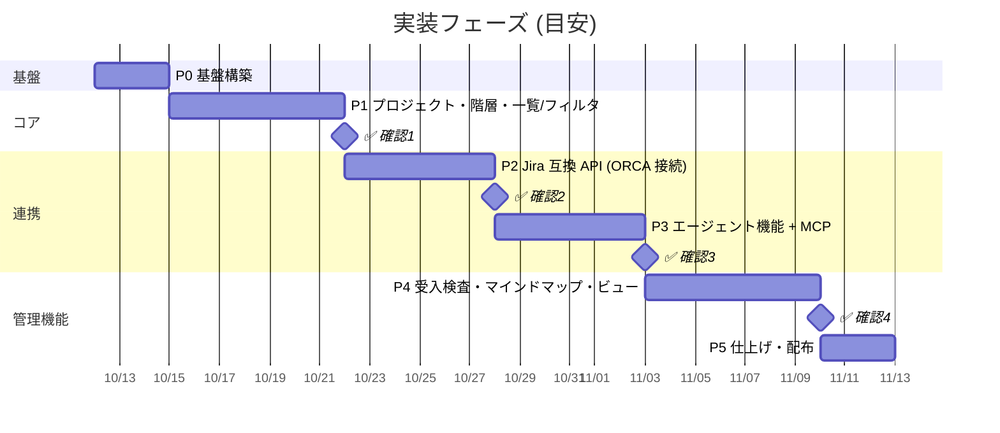

# 05. 実装計画

## 0. 進捗（2026-10-12 時点）

| フェーズ | 状態 |
|---|---|
| P0 基盤 / P1 コア | ✅ 完了・確認ポイント 1 レビュー済み |
| P3 エージェント機能 + MCP | ✅ 完了・確認ポイント 3 レビュー済み（P2 より先に実施） |
| P2 Jira 互換 API v3 | ✅ 完了・確認ポイント 2 レビュー済み（main にマージ済み） |
| P4 受入検査・マインドマップ・保存ビュー | ✅ 完了・確認ポイント 4 レビュー済み（指摘を反映して main にマージ済み） |
| P5 仕上げ・配布 | ✅ 完了・確認ポイント 5 レビュー済み（main にマージ済み） |
| 追加: 画面テスト・自動バックアップ | ✅ 完了・レビュー済み（確認ポイント 5 のあとの依頼。手順と結果は `docs/checkpoints/extra-1.md`） |
| 追加: 複数端末からの利用 | ✅ 実装完了・確認待ち（手順は `docs/checkpoints/extra-2.md`） |

## 1. 進め方

- 機能をまとまりごとに **フェーズ** に分け、各フェーズの終わりに **✅ 確認ポイント**（動くものを見てもらうレビュー）を置く。
- 確認ポイントでは、起動手順・操作シナリオ・既知の制限をまとめた `docs/checkpoints/phase-N.md` を用意する。
- 確認ポイントで出た指摘は次のフェーズの最初に反映する。
- 各フェーズで、Go のユニットテスト / API テスト、主要画面の Playwright テストを用意する。

## 2. フェーズ一覧

日程は 1 人 + Claude Code で進める場合の目安。

---

### P0 基盤構築

| # | 作業 | 成果物 |
|---|---|---|
| 0-1 | Go モジュール、ディレクトリ構成、`Makefile`（`dev`, `build`, `test`, `lint`） | `cmd/taskapp`, `internal/*` |
| 0-2 | SQLite 接続（WAL）、goose マイグレーション（素の SQL）、全テーブル作成 | `internal/store/migrations/001_init.sql` |
| 0-3 | API テストハーネス（`apitest/`: バイナリ起動 → HTTP で検証）と最初のテスト | `apitest/` |
| 0-4 | React + Vite + TS + Tailwind + TanStack Router/Query の雛形、Go への embed | `web/` |
| 0-5 | `taskapp serve` / `migrate` / `seed`（デモデータ: 1 プロジェクト、エピック〜タスク、エージェント 2 体） | |
| 0-6 | CI（GitHub Actions: go test, vitest, lint） | `.github/workflows/ci.yml` |

完了条件: `make dev` で UI の雛形が表示され、`taskapp seed` でデモデータが入る。

### P1 コア: プロジェクト・階層・一覧/フィルタ・マイタスク

| # | 作業 | 要求 |
|---|---|---|
| 1-1 | domain: 種別、ステータスカテゴリ、階層規則 `CanBeChild`（テーブル駆動テスト） | HIE-01〜04, 07 |
| 1-2 | service: プロジェクト CRUD、既定ステータス作成、キー採番 | PRJ-01〜03 |
| 1-3 | service: イシュー CRUD、親付け替え（循環チェック）、activities 記録 | ISS-01〜04, HIE-05 |
| 1-4 | domain.Filter と Filter → SQL、進捗集計（再帰 CTE） | VIEW-01, HIE-06 |
| 1-5 | 内部 API `/api/v1`（projects, issues, comments, activity, me）+ OpenAPI | |
| 1-6 | UI: レイアウト・サイドバー、プロジェクト一覧 | S05 |
| 1-7 | UI: イシュー一覧（リスト / ボード / ツリー）、フィルタバー、グルーピング、URL 同期 | S06, VIEW-01〜03, 06 |
| 1-8 | UI: イシュー詳細（サイドピーク）、作成モーダル、インライン編集 | S09, M01 |
| 1-9 | UI: マイタスク | S01, VIEW-04 |
| 1-10 | SSE によるリアルタイム更新 | NFR-04 |

#### ✅ 確認ポイント 1
- デモデータで、エピック → ストーリー → フィーチャー → タスク → タスク の階層を作成・付け替えできる
- 一覧をリスト/ボード/ツリーで切り替え、種別・担当・ステータスで絞り込める
- マイタスクに自分の担当が出る
- **確認したいこと**: 画面の操作感、階層規則（スキップ許可など）、フィルタ項目の過不足

### P2 Jira 互換 API v3（ORCA 接続）

| # | 作業 | 要求 |
|---|---|---|
| 2-1 | 認証: API トークン発行（CLI + 設定画面）、Basic（email + token）/ Bearer ミドルウェア。ユーザーのメールアドレス設定（seed にも email を入れる）が前提 | JIRA-03 |
| 2-2 | mapping: issue / project / user / status / issuetype / priority / comment の JSON 変換（v3 形式、`accountId`）と **ADF ⇔ Markdown 変換** | 4.10.3, JIRA-06 |
| 2-3 | JQL lexer / parser → domain.Filter（ORCA が生成する JQL のテストケース） | JIRA-04 |
| 2-4 | エンドポイント（`/rest/api/3`）: myself, serverInfo, project/search, search/jql (GET/POST), issue (GET/POST/PUT), assignee, transitions, comment | JIRA-01, 02 |
| 2-5 | エンドポイント: createmeta, priority, user/search, user/assignable/search, agile board / configuration | JIRA-02 |
| 2-6 | Jira 形式のエラー、ページング（project/search は startAt/maxResults/isLast、search/jql は nextPageToken） | JIRA-05 |
| 2-7 | ゴールデンテスト（ORCA のリクエスト形を再現）、curl スクリプト `scripts/jira-smoke.sh` | NFR-06 |
| 2-8 | ORCA 実機接続テスト（Cloud モード / REST API v3） | NFR-06 |

実施メモ（2026-10-12）:
- 2-1〜2-7 は実装済み。API テスト `apitest/tests/jira.test.ts`（32 件）と Go の単体テスト（JQL・ADF）で固定した。
- ORCA のソース（`stablyai/orca` `e736a9f`、インストール済み ORCA は 1.4.224）から Jira クライアント部分（`authenticated-request` / `jira-issue-mapping` / `jira-record-pages` / `adf-markdown`）を取り出し、通信部分だけを `fetch` に差し替えて本アプリに接続し、接続・一覧・詳細・コメント・遷移・作成・更新が ORCA 側の解析関数で正しく読めることを確認した。
- 2-8（ORCA アプリ本体からの接続）は確認ポイント 2 で行う。
- Jira 互換 API は Jira の仕様に合わせるため `api/openapi.yaml` には載せず、`apitest/tests/jira.test.ts` を契約とする。

#### ✅ 確認ポイント 2
- ORCA の Jira 設定（Cloud モード）にサイト URL `http://127.0.0.1:7700`、メールアドレス、API トークンを入れて接続できる
- ORCA のタスク一覧に本アプリのイシューが出て、詳細表示・作成・ステータス変更・コメントができ、本アプリ UI に即時反映される
- **確認したいこと**: ORCA 上での種別（Feature / Question）や階層の見え方、ORCA から使いたい操作の過不足

### P3 エージェント機能 + MCP

| # | 作業 | 要求 |
|---|---|---|
| 3-1 | service: チェックポイント記録・一覧、Jira コメントとの相互変換 | AGT-01〜03 |
| 3-2 | service: QA 起票・回答・クローズ、ブロッキング状態の集計 | QA-01〜06 |
| 3-3 | MCP サーバー（公式 Go SDK）: stdio (`taskapp mcp`) と Streamable HTTP (`/mcp`) | MCP-01〜03 |
| 3-4 | MCP ツール実装（14 種）と JSON Schema、ツール説明文の調整 | MCP-04 |
| 3-5 | MCP リソース・プロンプト（作業手順テンプレート） | MCP-05, 06 |
| 3-6 | stdio プロセス → serve への変更通知 | 02 §5.7 |
| 3-7 | UI: 詳細のチェックポイントタイムライン、QA バッジ | S09 |
| 3-8 | UI: QA インボックス、エージェント活動フィード、サイドバーのバッジ | S02, S04, QA-07, AGT-04, 05 |
| 3-9 | UI: 設定 › API トークン・連携情報（MCP 登録コマンドのコピー） | S12 |
| 3-10 | Claude Code から MCP 接続し、実タスクで「着手 → チェックポイント → QA → 回答取得 → 完了」を通す E2E | |

#### ✅ 確認ポイント 3
- Claude Code に `claude mcp add` で登録し、エージェントがタスクを取得・着手・チェックポイント記録・QA 起票できる
- QA インボックスで回答すると、エージェントが回答を取得して作業を続ける
- **確認したいこと**: チェックポイントの項目と粒度、QA の書式、エージェントへの指示テンプレート（プロンプト）

### P4 受入検査・マインドマップ・保存ビュー・ロードマップ

| # | 作業 | 要求 |
|---|---|---|
| 4-1 | 受入基準の編集、受入判定（基準別 OK/NG、合格/差し戻し）、履歴 | ACC-01〜04 |
| 4-2 | 判定時の警告（未完了の子、未回答 QA） | ACC-05 |
| 4-3 | UI: 受入検査画面 | S03 |
| 4-4 | ツリー API（進捗付き）、マインドマップ（React Flow、配置は自前のツリーレイアウト）、折りたたみ・ズーム・サイドピーク | MAP-01〜04 |
| 4-5 | マインドマップへのフィルタ適用（非該当ノードを薄く） | MAP-05 |
| 4-6 | 保存ビュー（CRUD、サイドバー表示、横断ビュー） | VIEW-05, S10 |
| 4-7 | ロードマップ（エピック/ストーリーの進捗） | VIEW-07, S07 |
| 4-8 | プロジェクト設定（ステータス・ラベル・階層スキップ） | PRJ-04, S11 |

実施メモ（2026-10-12）:
- 4-1〜4-8 を実装。API テスト `apitest/tests/acceptance.test.ts`（7 件）と `views.test.ts`（8 件、保存ビュー・ステータス・ラベル）を追加。
- マインドマップと ロードマップは新しい画面ではなく、イシュー一覧（S06）の表示切替（マップ / ロードマップ）として実装し、フィルタとサイドピークを共有する。ツリー API は一覧 API（`parent_key`・`progress` を含む）で足りたため追加していない。
- MAP-06（ドラッグで付け替え）・MAP-07（画像出力）は優先度 C のため P5 に残す。

#### ✅ 確認ポイント 4
- ストーリーの受入基準を定義 → 受入待ち → 判定（差し戻し・合格）の流れが動く
- マインドマップでプロジェクト全体を確認でき、ノードから詳細を開ける
- **確認したいこと**: マインドマップのレイアウトと情報量、受入検査の運用に合うか

### P5 仕上げ・配布

| # | 作業 |
|---|---|
| 5-1 | コマンドパレット、キーボードショートカット一式 (ISS-07) |
| 5-2 | エクスポート / インポート（JSON）、バックアップ手順 (NFR-02) |
| 5-3 | 性能確認（1 万件のシードで一覧・フィルタ・マップ）(NFR-03) |
| 5-4 | クロスビルド（macOS / Linux / Windows）と GoReleaser、README・利用ガイド |
| 5-5 | (C) 添付ファイル、マインドマップのドラッグ付け替え・画像出力 |

実施メモ（2026-10-12）:
- 5-1: `⌘K` / `Ctrl+K` のコマンドパレット（画面・プロジェクト・保存ビューへの移動、イシュー検索、新規作成）、`G` → `M`/`Q`/`A`/`E`/`P`/`S`、`?` でショートカット一覧。`J`/`K` の行移動、`S`/`A` のステータス・担当変更は入れていない。
- 5-2: `taskapp export / import / backup` と `GET /api/v1/export`。エクスポートはテーブル単位の JSON で、ID と API トークンのハッシュを含む（復元後も接続が切れない）。取り込みは空のデータディレクトリにだけ行える。API テスト `apitest/tests/export.test.ts`（6 件）。
- 5-3: `seed --preset perf`（4 プロジェクト × 2,560 件 = 10,240 件）と `scripts/perf.sh`。結果は下表。再帰クエリが `parent_id` の部分インデックスを使えていなかった点と、受入待ち一覧がイシューごとに問い合わせていた点を修正した。マップは 300 ノードを超えるとストーリーまで折りたたんだ状態で開く。
- 5-4: `make dist`（6 プラットフォーム、各 12MB 前後）と `.goreleaser.yaml`。README を書き直し、利用ガイド（06）とそのスライドを追加。Windows では動作未確認。
- 5-5: マップのドラッグでの親付け替えと PNG 出力を実装。添付ファイル（ISS-08）は保存先・アップロード画面・Jira の `/attachment/content` が必要になるため見送り。

| 計測（10,240 件、中央値） | 改善前 | 改善後 |
|---|---|---|
| プロジェクトの一覧（2,560 件中 2,000 件） | 60ms | 60ms |
| フィルタ（担当 = 自分 かつ 未完了、全プロジェクト） | 22ms | 23ms |
| フィルタ（ラベル + 種別） / テキスト検索 | 16ms / 20ms | 同左 |
| エピック配下（ツリー表示） | 665ms | 15ms |
| 受入待ち一覧（1,464 件） | 4,594ms | 65ms |
| Jira `search/jql`（ORCA の担当フィルタ） | 39ms | 39ms |
| マップ 2,560 ノードをすべて展開 / ズーム 1 フレーム | — | 約 420ms / 約 17ms |

### 追加作業（確認ポイント 5 のあと）

| # | 作業 |
|---|---|
| A-1 | 主要画面の自動テスト（Playwright） |
| A-2 | DB の自動バックアップと、バックアップからの復元 |
| A-3 | 複数端末からの利用: 画面のパスワードログイン、自動ログインはこの PC だけ、ほかの端末向けの接続情報（01 §4.12） |
| A-4 | サーバーへのデプロイの準備: リバースプロキシの後ろでの MCP（01 MD-09） |

実施メモ（2026-10-12）:
- A-1: `e2e/`（Playwright + Chromium、20 件）。テストごとに demo データ入りのサーバーを空きポートで起動し（API テストと同じハーネス）、画面で操作した結果を API でも確かめる。対象はイシュー一覧・詳細・作成・SSE での反映、QA 回答、受入検査（警告の対象一覧・合格・差し戻し）、コマンドパレットと `G` キー、保存ビュー、マップ（折りたたみ・ドラッグ付け替え・PNG）、設定（トークン・エクスポート・自動バックアップ）。`make test-e2e`。使い方は [07 テストの使い方](07-testing.md)。
- A-2: `serve` が起動時と 24 時間ごと（`--backup-interval`）に、DB が変わっていれば `<data>/backups/`（`--backup-dir`）へ複製し、新しい 7 件（`--backup-keep`）を残す。`GET/POST /api/v1/backups` と 設定 › データ の表示・「今すぐバックアップ」。`taskapp backup` は `--out` なしで同じフォルダへ。`taskapp restore --from FILE` で戻す（起動中は断り、いまの DB は退避）。API テスト `apitest/tests/backup.test.ts`（6 件）、Go の単体テスト `internal/backup`。使い方は [06 利用ガイド](06-guide.md) の「6. バックアップと復元」。
- A-3（2026-10-12。要望の案 1・2・4。ログインはパスワード、セッションはサーバー起動中だけ有効）: `users.password_hash`（マイグレーション 005、PBKDF2-SHA256）、`POST /auth/login`・`/auth/logout`・`GET /auth/options`・`PUT /users/{username}/password`、`taskapp passwd`。`/auth/local` は接続元と `Host` がループバックのときだけ。`--host` が外部向けなら起動時に警告し、設定画面に LAN の URL と MCP（HTTP）のコマンドを出す。MCP の HTTP 提供（案 2）は P3 で実装済みだったため、ほかの端末からの接続確認と案内の追加だけ。画面はログイン画面（S13）と 設定 › アカウント・ほかの端末から使う。オーナー以外にはオーナー用の設定を出さない。API テスト `apitest/tests/login.test.ts`（12 件）、画面テスト `e2e/tests/login.spec.ts`（7 件）、Go の単体テスト（ループバック判定・ハッシュ形式）。LAN の IP からの接続は手で確認。使い方は [06 利用ガイド](06-guide.md) の「7. ほかの端末から使う」。
- A-4（2026-10-12。公開は `tailscale serve` を想定）: `serve --behind-proxy`（MCP SDK の DNS リバインディング対策を外し、自動ログインを止める）と `--public-url`、`TASKAPP_OWNER`。API テスト `apitest/tests/proxy.test.ts`（4 件）、Go の単体テスト（`TASKAPP_OWNER`）。
- A-5（2026-10-12。要望: MCP の登録先を選んでコピーしたい、トークンを後から確認したい。トークンの扱いはオーナーが「サーバーに暗号化して保存」を選択）: 設定 › エージェントの接続（MCP）に Claude Code のスコープ（user / local / project）の切り替え。project は `.mcp.json` が git に入るので、トークンを `${TASKAPP_TOKEN}` にして `export` の行を出す。`api_tokens.token_enc`（マイグレーション 006、AES-256-GCM、鍵は `<data>/token.key`）と `POST /api/v1/tokens/{id}/reveal`。認証はハッシュのまま。トークン一覧の目のボタンで表示し、MCP・Jira のコマンドに入る。API テスト `apitest/tests/tokens.test.ts`（+2 件）、画面テスト `e2e/tests/settings.spec.ts`（+1 件、1 件を更新）。確認事項は [extra-4](checkpoints/extra-4.md)。
- A-6（2026-10-12。要望: 全プロジェクトのボード。列は分類・行はプロジェクト、入口はサイドバー、をオーナーが選択）: 画面 S14 全体ボード（`/board`）。各プロジェクトのステータスを読み、ドラッグ先の分類の最初のステータスへ移す（サーバーの変更なし）。プロジェクトを指定しない保存ビューのボード表示も同じ形にした（それまでは列が出なかった）。`G` → `B`。画面テスト `e2e/tests/board.spec.ts`（2 件）。確認事項は [extra-5](checkpoints/extra-5.md)。
- A-8（2026-10-12。要望: この構成でどれぐらいの規模まで使えるか、想定容量の到達率を確かめたい）: `GET /api/v1/capacity`（件数・データとディスクの大きさ・メモリ。オーナーのみ）と 設定 › 利用状況と上限（1 万件・一覧の読み込み 2,000 件・マップ 1,000 ノード・ディスクに対する到達率）。一覧・ボードで読み込み上限を超えたときのお知らせ。API テスト `apitest/tests/capacity.test.ts`（2 件）、画面テスト（+1 件）。確認事項は [extra-7](checkpoints/extra-7.md)。
- A-7（2026-10-12。要望: デプロイのたびにログアウトされるのをやめたい、ログインを保持するチェックがほしい）: セッションを DB に保存（マイグレーション 007 `sessions`、Cookie の値の SHA-256）。ログイン画面に「ログインしたままにする（30 日）」。期限は最後の使用から 1 日 / 30 日で、使うたびに延びる。https なら Cookie に Secure。エクスポートに入れない。API テスト `apitest/tests/login.test.ts`（+3 件。ハーネスに再起動 `restart()` を追加）、画面テスト `e2e/tests/login.spec.ts`（+1 件）。確認事項は [extra-6](checkpoints/extra-6.md)。
- A-6 追加（2026-10-12。要望: 件数をプロジェクトごとにも）: 全体ボードの行ごとの各列に、そのプロジェクトの件数とステータスの内訳を出す。たたんだ行にも件数。
- A-9（2026-11-01。要望: 重要なプロジェクトとそうでないものを分けてボードを見たい、操作系は左に。名前は「保留」ではなく低優先・お試しも含むもの、とオーナーが指定）: `projects.tier`（マイグレーション 008。`focus` / `normal` / `side`、既定 `normal`）、作成・更新・一覧で返す。フィルタ項目 `project_tier`。全体ボードはティアの段に分け、「その他」の行は最初からたたむ。「注力のみ」、行の見出し・プロジェクト一覧のカード・プロジェクト設定からティアを変える。プロジェクト一覧とサイドバーもティアの順。一覧系の画面のヘッダーとフィルタバーの操作を左寄せ（QA インボックス・エージェント活動のヘッダーも）。API テスト（+2 件、1 件を更新）、画面テスト `e2e/tests/board.spec.ts`（+1 件）。確認事項は [extra-8](checkpoints/extra-8.md)。
- A-10（2026-11-02。要望: マイタスクの使い方がわからなくなってきたので、ペルソナ・ストーリーマッピングなどの要求の管理を開発に組み込みたい。オーナーが「今のアプリの拡張で検証・利用者は本人と AI だけ・題材はマイタスク」を選択）: 設計のみ。提案スライド `docs/slides/devcycle.html`、設計書 [08 開発サイクル](08-devcycle.md)（マイタスクの棚卸しと M1 設計）、スライド `docs/slides/storymap.html`。確認事項は [extra-9](checkpoints/extra-9.md)。
- A-11（2026-11-02。オーナーが案 A（要求は別のテーブル）で実装、UI と DB の変更点を ER 図で、を指定）: M1 を実装。マイグレーション 009（`req_*` 11 テーブル。既存のテーブルは変更なし）、`internal/service/requirements.go`、API 25 操作（`/projects/{key}/storymap` ほか）、イシュー詳細に `stories`、MCP `get_storymap`。画面 S15 ストーリーマップ・S16 ストーリー詳細（ペルソナ・ジョブのパネル）、S06 に入口、S09 に「満たすストーリー」と「ストーリーの条件から写す」。demo データにマップ。API テスト `apitest/tests/storymap.test.ts`（9 件）と契約（+3）、画面テスト `e2e/tests/storymap.spec.ts`（4 件）、Go の単体テスト（+2）。変更点のスライド `docs/slides/m1.html`。確認事項は [extra-10](checkpoints/extra-10.md)。
- A-12（2026-11-02。オーナーが「M1 は固すぎる。UI はこのまま進め、構造がゆるい別の案も」と指定）: 提案だけ。M1 の固いところ K1〜K6 を挙げ、案 B 要求メモ・案 C イシューで書く・案 D M1 をゆるく使う（おすすめ）を比べた。文書 [09](09-requirements-loose.md)、スライド `docs/slides/loose.html`。確認事項は [extra-11](checkpoints/extra-11.md)。
- A-15（2026-11-02。オーナーが「4 つの案を task-app-next に実装し、対応案のスライドも」と指定。案 D の担当）: ブランチ `exp/req-d`（`task-app-next/d-loose`）。M1 の上に、マイグレーション 010（`req_stories.body`）、S15 のひとこと入力と「未整理」の列、S16 の本文と 1 行の条件（前提・操作は「詳しく」）、ペルソナ・活動は使うときだけ、抜けは数だけ、MCP `create_story`・`update_story` と「聞いてから直す」流れ。demo に未整理のストーリー 2 件。API テスト `apitest/tests/storymap-loose.test.ts`（5 件）、画面テスト `e2e/tests/storymap-loose.spec.ts`（3 件）。スライド `docs/slides/req-d.html`。確認事項は [extra-14](checkpoints/extra-14.md)。
- A-16（2026-11-02。オーナーが「案 D と案 A を両立できるか。プロジェクト単位で選べてもよい」と問い、名前を structured / quick に決めた）: ブランチ `exp/req-e`（`task-app-next/e-both`、案 D の上）。マイグレーション 011（`projects.requirements_mode`、既存は structured、新規は quick）、プロジェクト設定の「要求の書き方」、S15・S16 をモードで切り替え、マップのヘッダーにモード、`get_storymap` に `mode`、MCP の説明。API テスト `apitest/tests/requirements-mode.test.ts`（4 件）、画面テスト `e2e/tests/storymap-mode.spec.ts`（2 件）。スライド `docs/slides/req-e.html`。確認事項は [extra-15](checkpoints/extra-15.md)。
- A-17（2026-11-02。オーナーが「リリースのまとまりは地図で示したい」と指定）: ブランチ `exp/req-e`。マイグレーション 012（`req_releases`: 名前・ねらい・状態・目安・並び）、名前の変更はストーリーに付いてくる、ストーリーに書いた新しい名前でまとまりができる、REST `/projects/{key}/releases`、`get_storymap` の `release_slices`、MCP `update_release`、S15 の行見出し（ねらい・状態・n/m 完了・次に出す の線）。API テスト `apitest/tests/releases.test.ts`（6 件）、画面テスト `e2e/tests/storymap-releases.spec.ts`（2 件）。設計は [08 §5.8](08-devcycle.md)、確認事項は [extra-16](checkpoints/extra-16.md)。
- A-18（2026-11-03。オーナーが「ストーリーマップは試行錯誤してから決まる。一時的な試行の場所で決めて、一気に入れたい」と指定し、4 案から「下書き用のプロジェクトから取り込む」を選んだ）: ブランチ `feat/req-drafts`（本体 `task-app`）。マイグレーション 013（`projects.draft_of`、`req_draft_links`）、下書きの作成（複製 / 空）、取り込みの予定（3 者比較、衝突、元にしかないもの）、1 トランザクションの取り込み（人だけ、衝突は force）、REST `/projects/{key}/drafts`・`/import-plan`・`/import`、MCP `create_draft`・`get_import_plan`、S15 の「下書き」メニュー・下書きの帯・取り込みの予定。ヘッダーのポップオーバーを画面に固定して出すようにした（横にスクロールするヘッダーの中で切れないように）。API テスト `apitest/tests/drafts.test.ts`（13 件）、画面テスト `e2e/tests/storymap-drafts.spec.ts`（2 件）。設計は [08 §5.9](08-devcycle.md)、確認事項は [extra-17](checkpoints/extra-17.md)。
- A-19（2026-11-04。オーナーが「ペルソナと活動も MCP で入れられるように」と指定）: ブランチ `feat/mcp-personas-activities`。MCP `create_persona`・`update_persona`・`create_activity`（手順つき）・`update_activity`・`create_step`・`update_step`、`create_story` に `persona_key`・`i_want`・`so_that`。API テスト `apitest/tests/mcp-storymap.test.ts`（3 件）。設計は [08 §5.10](08-devcycle.md)。

## 3. テスト戦略と置き換え可能性（Rust への置き換えに備える）

バックエンドを将来 Rust 等へ置き換えても、**同じテストが通れば同じ振る舞い** と言える状態を保つ。

### 3.1 言語非依存の「契約」

| 契約 | 内容 | 置き場所 |
|---|---|---|
| 内部 API | `/api/v1` の OpenAPI 定義。Web UI とテストの TS 型はここから生成 | `api/openapi.yaml` |
| Jira 互換 API | エンドポイント表（01 §4.10）と、期待する JSON のゴールデンファイル | `apitest/fixtures/jira/` |
| MCP | ツール名・入力 JSON Schema・出力形式 | `apitest/fixtures/mcp/` |
| DB スキーマ | 素の SQL マイグレーション（`-- +goose Up/Down`） | `internal/store/migrations/` |
| CLI | 下表のサブコマンドと出力形式 | 本節 |

CLI の契約（テストハーネスはこれだけを使う）:

| コマンド | 振る舞い |
|---|---|
| `taskapp serve --data <dir> --port <n>` | `--port 0` なら空きポート。準備完了時に標準出力へ 1 行の JSON `{"event":"ready","addr":"127.0.0.1:NNNNN"}` を出す |
| `serve` の `--backup-interval <時間>` / `--backup-keep <n>` / `--backup-dir <dir>` | 自動バックアップ。既定は `24h` / `7` / `<dir>/backups`。起動時に 1 件取り（既にあり、間隔内または DB が未変更なら取らない）、以降は間隔ごと。ファイル名は `taskapp-YYYYMMDD-HHMMSS.db`（同じ秒なら `-N` を付ける）。`--backup-interval 0` で自動を止める。`0` 件保持はすべて残す |
| `taskapp migrate --data <dir>` | マイグレーション適用 |
| `taskapp seed --data <dir> --preset <name>` | プリセットのデータ投入（`demo`, `test`, `perf`） |
| `taskapp token create --data <dir> --user <username> --name <name>` | 生のトークンを標準出力に 1 行で出す |
| `taskapp mcp --data <dir>` | MCP stdio サーバー（`TASKAPP_TOKEN` で認証） |
| `taskapp passwd --data <dir> --user <username> [--clear]` | 人間のログイン用パスワードを設定する。端末なら 2 回入力、そうでなければ標準入力の 1 行目。8 文字以上。エージェントには設定できない。`--clear` で解除 |
| `serve` の `--host <addr>` / `--require-login` | 既定は `127.0.0.1`。ループバック以外なら標準エラーに警告を出す（`ready` 行は変えない）。`--require-login` でこの PC からの自動ログイン（`/auth/local`）も止める |
| `serve` の `--behind-proxy` / `--public-url <url>` | `--behind-proxy`: 同じマシンのリバースプロキシから公開名の `Host` で届く `/mcp` を受け付ける（トークンは必須のまま）。`--require-login` も兼ねる。`--public-url`: `GET /server` の `remote_url` にする（末尾の `/` は外す） |
| 環境変数 `TASKAPP_OWNER` | オーナーがまだいないときに作るオーナーのユーザー名（英小文字・数字・`._-` 以外は除く）。なければ OS のユーザー名 |
| `taskapp export --data <dir> [--out <file>]` | 全データを JSON で出力（`--out` なしは標準出力）。形式は `{format: 1, schema_version, exported_at, tables: {テーブル名: [行...]}}` |
| `taskapp import --data <dir> --in <file>` | 空のデータディレクトリにエクスポートを取り込む。成功時に標準出力へ `{"event":"imported","rows":{...}}`。データがあれば失敗 |
| `taskapp backup --data <dir> [--out <file>]` | SQLite ファイルの一貫した複製を作る（起動中でも可。既存ファイルには書かない）。`--out` なしは `--backup-dir`（既定 `<dir>/backups`）に自動と同じ名前で作り、そのパスを標準出力に 1 行で出す。古いものは消さない（`--backup-keep N` を付けたときだけ、新しい N 件を残して消す） |
| `taskapp restore --data <dir> --from <file>` | バックアップで DB を置き換える。同じデータディレクトリで `serve` が動いていれば失敗（`stop it first`）。taskapp の DB でなければ失敗（`not a taskapp database`）。いまの DB は `taskapp.db.before-restore-<日時>` に残す |

### 3.2 テストの層

| 層 | 対象 | 技術 | Rust 置き換え時 |
|---|---|---|---|
| API テスト（主） | `/api/v1`、Jira 互換、MCP（HTTP / stdio） | TypeScript + Vitest。`$TASKAPP_BIN` を起動して HTTP / MCP クライアント（公式 TS SDK）で検証 | **そのまま流用**（`TASKAPP_BIN` を差し替えるだけ） |
| 単体テスト | 階層規則、JQL パーサ、Filter → SQL | Go `testing` | 実装と一緒に書き直す |
| 画面テスト | 主要画面の操作 | Playwright（`e2e/`）。API テストと同じハーネスで `$TASKAPP_BIN` を起動し、ブラウザで操作して結果を API で確かめる | **そのまま流用**（Web UI を埋め込んだバイナリであること） |

- 各フェーズの要求は、まず API テストとして書く（P1: イシュー CRUD・階層規則・フィルタ、P2: Jira 互換、P3: MCP）。
- テストは毎回空のデータディレクトリでサーバーを起動し、`seed --preset test` の決まったデータを使う（決定的な ID・トークン）。
- 画面テストは `seed --preset demo` のデータを使い、テストごとに新しいサーバーを起動する（並列に流せる）。
- 流し方と書き足し方は [07 テストの使い方](07-testing.md)。CI を用意するときは Go のビルド → API テスト → Web UI を含むビルド → 画面テストの順で実行する。

## 4. リスクと対策

| リスク | 影響 | 対策 |
|---|---|---|
| ORCA が想定外のエンドポイント/フィールドを要求する | 接続できない | P2 冒頭で ORCA の通信を記録（リクエストログを出す `--log-requests`）し、足りないものを追加。ORCA のバージョンを記録しておく |
| ORCA が `Feature`/`Question` 種別や深い階層を想定していない | 表示が崩れる | 種別名のマッピングを設定可能にする（例: Feature → Story 表示） |
| JQL の未対応構文 | 検索エラー | Jira と同じエラー文言で 400 を返し、ORCA のテキスト検索フォールバックに乗せる。未対応構文はログに残して追加判断 |
| stdio MCP と serve の同時書き込み | ロック競合 | WAL + `busy_timeout`、書き込みトランザクションを短く保つ |
| マインドマップの大規模表示 | 描画が重い | 初期は 2 階層まで展開、折りたたみ、ビューポート外の非描画 |

## 5. 着手順の提案

P0 → P1 → ✅1 の順で進め、確認ポイント 1 で画面の方向性を決めてから P2 以降に進む。P2（ORCA 連携）と P3（MCP）は、確認ポイント 1 のフィードバック次第で順番を入れ替えられる。
