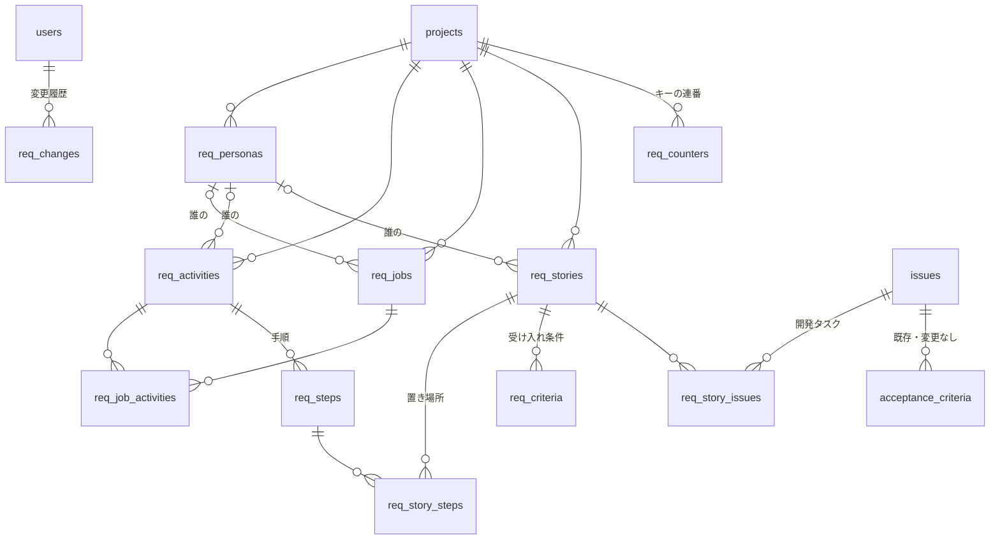

# ✅ 確認: M1 実装（要求の層）— UI と DB の変更点（追加作業 A-11）

オーナーの指定（2026-11-02）: 案 A（要求はイシューとは別のテーブル）で一度実装し、UI と DB の変更点を ER 図で示す。ブランチは `docs/devcycle-proposal`（まだ push・PR していない）。

変更点のスライド: [M1 実装: UI と DB の変更点](../slides/m1.html)（12 枚。ER 図、テーブル一覧、画面の写真）。ER 図は [04](../04-er-diagram.md) と ER のスライドにも追加。

## DB（マイグレーション 009）

新しいテーブル 11。**既存のテーブルは 1 列も変えていない**。イシューとは `req_story_issues` だけでつながる。

- 消すときはアーカイブ（`archived_at`）。キーは使い回さない（`req_counters`）。
- カードの色（`status`）は保存せず、つながったイシューの状態から毎回計算する。
- 既存の受入基準（`acceptance_criteria`）はそのまま。ストーリーの受け入れ条件から写すだけ。

## UI

| 画面 | 区分 | 内容 |
|---|---|---|
| S15 ストーリーマップ `/p/:key/storymap` | 新規 | 活動と手順を横、リリースを縦。カードの色、抜けの一覧、ペルソナで絞り込み、その場で追加 |
| S16 ストーリー詳細 | 新規 | S15 のサイドピーク。受け入れ条件（Given/When/Then）、イシューのつなぎ外し、変更履歴 |
| ペルソナとジョブ | 新規 | S15 の左のパネル |
| S06 イシュー一覧 | 変更 | ヘッダーに「ストーリーマップ」 |
| S09 イシュー詳細 | 変更 | 「満たすストーリー」、受入基準に「ストーリーの条件から写す」 |

## API・MCP

API 25 操作（`/api/v1/projects/{key}/storymap`・`personas`・`jobs`・`activities`・`steps`・`stories`・`criteria`、ストーリーとイシューのつなぎ外し）。`GET /issues/{key}` に `stories`。MCP は `get_storymap` を追加、`get_issue` に `stories`。

## 確認済みのこと

- Go の単体テスト（+2）、API テスト 201 件（+12）、画面テスト 38 件（+4）がすべて成功した。
- demo データで S15・S16・パネル・S09 を画面で確かめ、スライドに写真を載せた。

## 確認したいこと

1. この ER 図・画面でよいか。
2. PR を出し、マージ後にデプロイしてよいか。デプロイ後に 08 のペルソナ・ジョブ・マップを本番の TAPP に登録する。
3. マイタスクの整理 T1〜T5 を TAPP のストーリー（リリース R1）として置き、M1 の仕組みで回してよいか。
